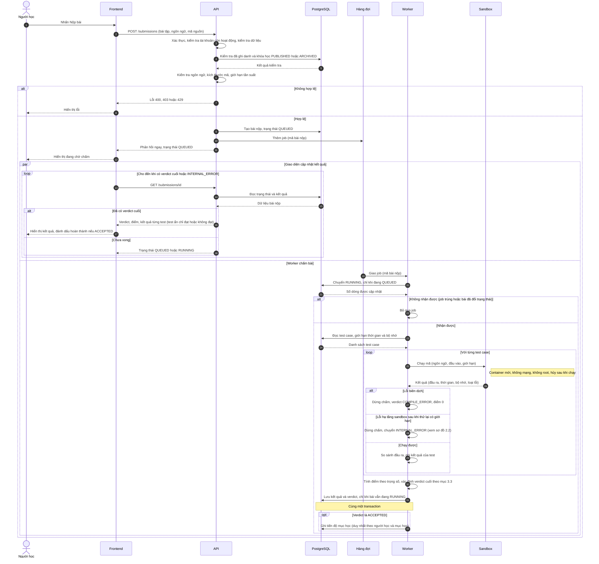
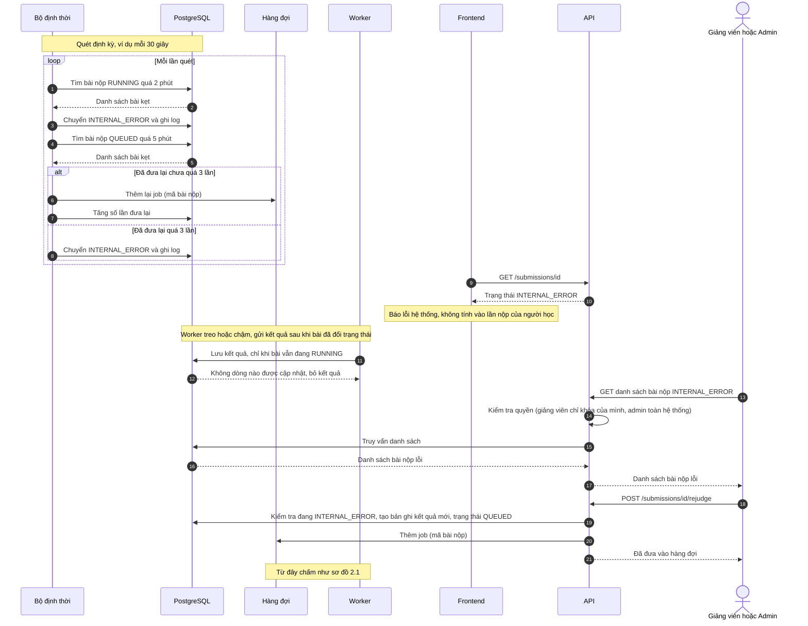
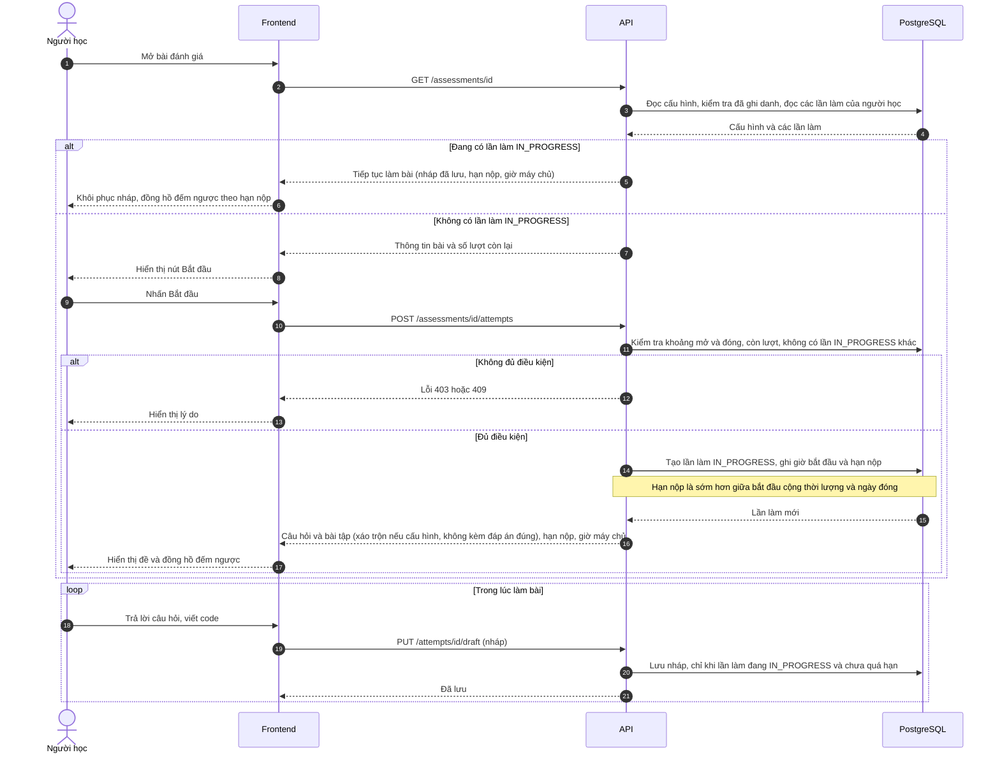
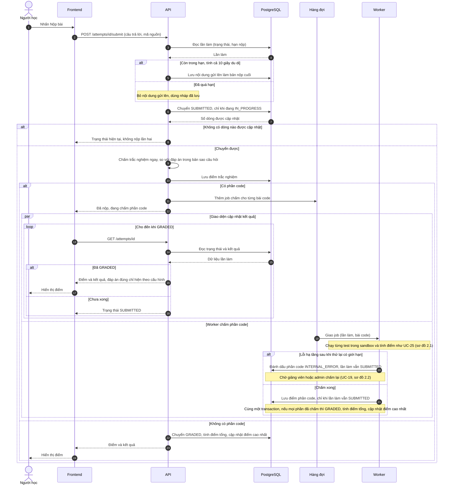
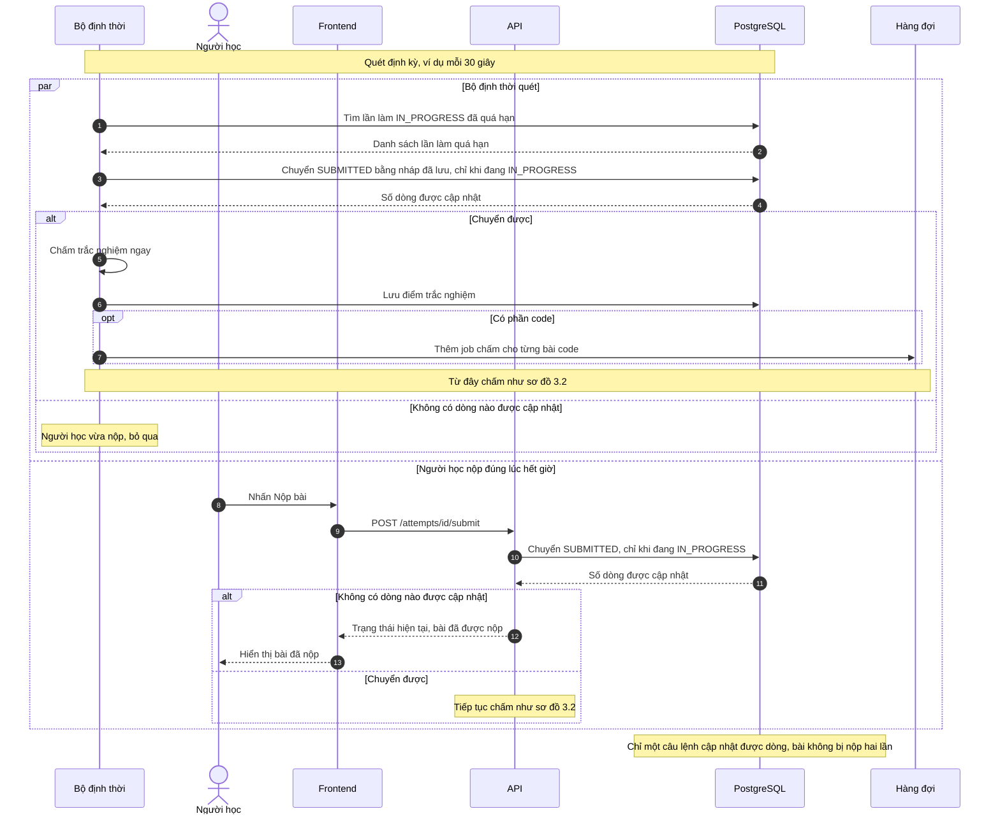

# CodePath — Sơ đồ tuần tự

| | |
|---|---|
| **Phiên bản** | 1.1 |
| **Tài liệu liên quan** | `requirements.md` (v1.1), `use-case.md` (v1.1), `state-diagrams.md` (v1.1) |

> Tên endpoint trong sơ đồ chỉ để minh họa, chưa phải đặc tả API. Khi có đặc tả API, cần cập nhật cho khớp.

## Mục lục

1. [Các thành phần tham gia](#1-các-thành-phần-tham-gia)
2. [UC-09 — Nộp bài và xem kết quả chấm](#2-uc-09--nộp-bài-và-xem-kết-quả-chấm)
3. [UC-11 — Làm bài đánh giá](#3-uc-11--làm-bài-đánh-giá)

---

## 1. Các thành phần tham gia

| Thành phần | Vai trò | Công nghệ (§1.2) |
|---|---|---|
| Người học | Tác nhân chính | — |
| Frontend | Trình soạn code, hiển thị trạng thái và kết quả | React, Monaco |
| API | Kiểm tra quyền, tạo bài nộp, trả kết quả | Express.js, Zod |
| PostgreSQL | Lưu bài nộp, kết quả từng test, tiến độ | PostgreSQL, Prisma |
| Hàng đợi | Chuyển việc chấm bài sang worker | Redis, BullMQ |
| Worker | Lấy việc, chạy test, tính điểm và verdict (UC-25) | Node.js |
| Sandbox | Chạy mã cô lập (UC-27) | Docker hoặc Judge0 |
| Bộ định thời | Phục hồi bài nộp kẹt (UC-26) | — |

## 2. UC-09 — Nộp bài và xem kết quả chấm

### 2.1 Luồng chính

Gồm: kiểm tra yêu cầu, tạo bài nộp `QUEUED`, chấm bất đồng bộ qua hàng đợi, và giao diện cập nhật kết quả. Giao diện và worker chạy song song sau khi API đã phản hồi.

| Bước | Hành động | Ràng buộc liên quan |
|---|---|---|
| 3–6 | Kiểm tra xác thực, quyền, dữ liệu vào, ngôn ngữ, kích thước, tần suất | BR-05, BR-13, BR-14, NFR-02, NFR-03, NFR-06, FR-31 |
| 7–8 | Từ chối khi không hợp lệ (400, 403, 429) | UC-09 (2a, 2b), BR-14, AC-22 |
| 9–11 | Tạo bài nộp `QUEUED`, đưa vào hàng đợi, phản hồi ngay, không nhận điểm hay verdict từ client | BR-08, NFR-09, FR-28 |
| 12–18 | Giao diện hiển thị đang chờ rồi cập nhật tự động, không cần tải lại trang | AC-21 |
| 19–22 | Worker nhận job và chuyển `RUNNING` chỉ khi đang `QUEUED`, nên job lặp không chấm hai lần | BR-11, NFR-11 |
| 25–26 | Mỗi test chạy trong sandbox riêng, theo ràng buộc cô lập | BR-10, NFR-07, §3.6, UC-27 |
| 27–28 | Lỗi biên dịch dừng chấm với điểm 0; lỗi hạ tầng chuyển `INTERNAL_ERROR` | §3.3, UC-25 |
| 30 | Tính điểm bằng tổng trọng số test đạt, xác định verdict theo quy tắc ưu tiên | §3.3, AC-15, AC-16, AC-44 |
| 31–32 | Lưu kết quả và tiến độ trong một transaction, chỉ khi bài vẫn `RUNNING` | NFR-12, NFR-13, BR-12, AC-24 |
| 16 | Test ẩn chỉ trả đạt hoặc không đạt, không trả dữ liệu | BR-09, AC-20, FR-29 |

### 2.2 Luồng sự cố: bài nộp kẹt và chấm lại

Áp dụng khi worker treo, sandbox hỏng hoặc hàng đợi mất việc (luồng thay thế 5c của UC-09). Bộ định thời phục hồi bài nộp (UC-26), sau đó giảng viên hoặc admin chấm lại (UC-19). Các nhóm sự kiện trong sơ đồ độc lập với nhau, được xếp theo trình tự của một kịch bản điển hình.

| Bước | Hành động | Ràng buộc liên quan |
|---|---|---|
| 1–3 | Bài `RUNNING` quá 2 phút chuyển `INTERNAL_ERROR` | §3.3, UC-26, AC-23 |
| 4–8 | Bài `QUEUED` quá 5 phút được đưa lại hàng đợi, tối đa 3 lần, vượt quá thì `INTERNAL_ERROR` | §3.3, UC-26, AC-23 |
| 9–10 | Giao diện báo lỗi hệ thống, bài không tính vào lần nộp | §3.3, UC-09 (5c) |
| 11–12 | Kết quả đến muộn bị bỏ qua nhờ điều kiện trạng thái khi lưu | §3.3, BR-11 |
| 13–21 | Chấm lại tạo bản ghi kết quả mới, ghi nhận người thực hiện | UC-19, BR-07, BR-11, FR-32 |

### 2.3 Điểm thiết kế cần xác nhận

1. **Cập nhật kết quả bằng polling.** §3.3 cho phép polling hoặc SSE/WebSocket. Sơ đồ dùng polling vì đơn giản; chuyển sang SSE chỉ thay vòng lặp ở khối giao diện, không đổi phần còn lại.
2. **Tạo bài nộp rồi mới đưa vào hàng đợi, không nguyên tử.** Nếu API lỗi giữa hai bước, bài nộp nằm ở `QUEUED` mà không có job, và chỉ được đưa lại sau 5 phút nhờ UC-26. Chấp nhận độ trễ này, hay dùng outbox, hay trả lỗi ngay cho người học khi đưa vào hàng đợi thất bại?
3. **Chạy hết test case.** Điểm bằng tổng trọng số test đạt nên worker chạy toàn bộ test, chỉ dừng khi biên dịch lỗi hoặc hạ tầng lỗi. Với bài nhiều test, thời gian chấm tăng theo số test (liên quan NFR-10).
4. **Biên dịch lặp lại.** Mỗi test chạy trong sandbox riêng (§3.3) và UC-27 biên dịch trong từng lần chạy. Biên dịch một lần rồi dùng lại là tối ưu triển khai, không đổi hành vi. Nên gắn với quyết định Judge0 hay runner tự xây (câu hỏi mở 1).
5. **Số lần đưa lại.** Bộ định thời cần đếm số lần đưa lại cho mỗi bài `QUEUED`. Requirements chưa quy định chỗ lưu (cột riêng hay dùng bộ đếm retry của BullMQ), cần chốt khi thiết kế CSDL.

---

## 3. UC-11 — Làm bài đánh giá

Bài đánh giá gồm câu trắc nghiệm (chấm ngay) và bài code (chấm qua hàng đợi như UC-09). Mọi mốc thời gian do **đồng hồ máy chủ** quyết định (BR-15). Phần chấm code dùng lại luồng worker và sandbox ở mục 2.1 nên không vẽ lại chi tiết.

### 3.1 Bắt đầu, tiếp tục và làm bài

| Bước | Hành động | Ràng buộc liên quan |
|---|---|---|
| 1–4 | Mở bài, đọc cấu hình, kiểm tra đã ghi danh | FR-33, BR-05 |
| 5–6 | Đang có lần làm `IN_PROGRESS` thì tiếp tục: khôi phục nháp, đồng hồ theo giờ máy chủ | UC-11 (luồng tiếp tục), §3.4, BR-15 |
| 7–13 | Bắt đầu lần làm mới, từ chối nếu ngoài khoảng mở/đóng, hết lượt hoặc đang có lần `IN_PROGRESS` | BR-16, AC-27, UC-11 (1a, 1b) |
| 14–17 | Tạo lần làm, hạn nộp là sớm hơn giữa bắt đầu cộng thời lượng và ngày đóng; trả đề không kèm đáp án đúng | §3.4, BR-09, BR-15, AC-25 |
| 18–21 | Tự lưu nháp định kỳ, chỉ khi còn hạn | FR-33, BR-15, AC-26 |

### 3.2 Nộp bài và chấm

Người học nộp, hệ thống chấm trắc nghiệm ngay rồi đưa phần code vào hàng đợi. Lần làm chỉ chuyển `GRADED` khi mọi phần đã chấm.

| Bước | Hành động | Ràng buộc liên quan |
|---|---|---|
| 1–4 | Người học nộp, API đọc trạng thái và hạn nộp của lần làm | FR-33, BR-15 |
| 5 | Còn trong hạn (cộng 10 giây du di) thì dùng nội dung gửi lên; quá hạn thì bỏ nội dung và dùng nháp đã lưu | BR-15, AC-26, UC-11 (4a) |
| 6–8 | Chuyển `SUBMITTED` chỉ khi đang `IN_PROGRESS`, nên nộp lần hai không có hiệu lực | UC-11 (4b), §3.4 |
| 9–10 | Chấm trắc nghiệm ngay, điểm do máy chủ tính | FR-34, BR-08, BR-18 |
| 11–12 | Phần code đưa vào hàng đợi, người học thấy đã nộp | FR-34, UC-25 |
| 13–18 | Giao diện cập nhật đến khi `GRADED`; đáp án đúng chỉ hiện theo cấu hình | BR-17, AC-28 |
| 19–21 | Worker chấm phần code; lỗi hạ tầng thì phần code `INTERNAL_ERROR`, lần làm vẫn `SUBMITTED` chờ chấm lại; chấm xong thì lưu điểm, kiểm tra mọi phần, chuyển `GRADED`, cập nhật điểm cao nhất | §3.4, BR-11, BR-19, AC-23, AC-40, NFR-12 |
| 22–24 | Không có phần code thì chuyển `GRADED` ngay | §3.4, BR-19 |

### 3.3 Hết giờ: tự nộp và nộp trùng thời điểm

Bộ định thời tự nộp các lần làm quá hạn (UC-26). Nếu người học cũng nộp đúng lúc đó, chỉ một bên thành công vì cả hai dùng cùng điều kiện trạng thái (UC-11, luồng 4b).

| Bước | Hành động | Ràng buộc liên quan |
|---|---|---|
| 1–4 | Bộ định thời tìm lần làm quá hạn và chuyển `SUBMITTED` bằng nháp đã lưu, chỉ khi đang `IN_PROGRESS` | UC-26, BR-15, AC-25 |
| 5–7 | Chấm trắc nghiệm, đưa phần code vào hàng đợi | UC-26, UC-25 |
| 8–13 | Người học nộp cùng lúc: bên đến sau không cập nhật được dòng nào nên không nộp hai lần | UC-11 (4b), UC-26 (2a), NFR-11 |

### 3.4 Điểm thiết kế cần xác nhận

1. **Quay lại sau khi hết hạn nhưng trước lần quét của bộ định thời.** Máy chủ quyết định thời gian (BR-15), nên API cần nộp bằng nháp đã lưu thay vì cho tiếp tục làm bài. UC-11 chưa nêu rõ trường hợp này.
2. **Ai chuyển `GRADED`.** Nếu không có phần code, API chuyển ngay. Nếu có, worker xử lý phần code sau cùng sẽ chuyển trong cùng transaction với việc lưu điểm. Cách khác là để bộ định thời quét các lần làm `SUBMITTED` đã chấm đủ, nhưng thêm độ trễ.
3. **Một lần làm `IN_PROGRESS` cho mỗi cặp người học và bài đánh giá.** Để hai tab bấm Bắt đầu cùng lúc không tạo hai lần làm, cần ràng buộc ở CSDL (duy nhất một phần theo trạng thái). NFR-13 chưa liệt kê ràng buộc này.
4. **Lưu nháp sau hạn.** BR-15 chỉ nói về nội dung nộp. Sơ đồ giả định nháp gửi sau hạn (cộng 10 giây du di) cũng bị bỏ qua.
5. **Chấm trắc nghiệm đồng bộ.** API và bộ định thời chấm ngay vì chỉ so khớp đáp án. Nếu bài rất nhiều câu có thể chuyển sang worker mà không đổi hành vi.
6. **Kết quả phần code không vào lịch sử bài nộp (BR-19).** Worker dùng lại luồng UC-25 nhưng ghi kết quả theo lần làm. Khi thiết kế ERD cần tách bảng kết quả hoặc đánh dấu nguồn của kết quả.
7. **Lần làm bị bỏ dở có tính lượt không.** Requirements chưa nói. Sơ đồ coi mọi lần làm đã bắt đầu là đã dùng một lượt, kể cả khi bị tự nộp lúc hết giờ. Cần chốt, vì ảnh hưởng đến BR-16.