# CodePath — Sơ đồ tuần tự

| | |
|---|---|
| **Phiên bản** | 1.1 |
| **Tài liệu liên quan** | `requirements.md` (v1.1), `use-case.md` (v1.1), `state-diagrams.md` (v1.1) |

> Tên endpoint trong sơ đồ chỉ để minh họa, chưa phải đặc tả API. Khi có đặc tả API, cần cập nhật cho khớp.

## Mục lục

1. [Các thành phần tham gia](#1-các-thành-phần-tham-gia)
2. [UC-09 — Nộp bài và xem kết quả chấm](#2-uc-09--nộp-bài-và-xem-kết-quả-chấm)
3. [UC-11 — Làm bài đánh giá](#3-uc-11--làm-bài-đánh-giá)
4. [UC-01, UC-02 — Đăng ký, đăng nhập và quản lý phiên](#4-uc-01-uc-02--đăng-ký-đăng-nhập-và-quản-lý-phiên)
5. [UC-08 — Chạy thử code](#5-uc-08--chạy-thử-code)
6. [UC-17, UC-28, UC-20 — Gửi duyệt và kiểm duyệt khóa học](#6-uc-17-uc-28-uc-20--gửi-duyệt-và-kiểm-duyệt-khóa-học)
7. [UC-29 — Làm mục học QUIZ](#7-uc-29--làm-mục-học-quiz)
8. [UC-06 — Ghi danh và hủy ghi danh khóa học](#8-uc-06--ghi-danh-và-hủy-ghi-danh-khóa-học)
9. [UC-07 — Học nội dung và đánh dấu hoàn thành](#9-uc-07--học-nội-dung-và-đánh-dấu-hoàn-thành)
10. [UC-15 — Tạo bài tập code và test case](#10-uc-15--tạo-bài-tập-code-và-test-case)
11. [UC-16 — Tạo mục QUIZ và soạn câu hỏi](#11-uc-16--tạo-mục-quiz-và-soạn-câu-hỏi)
12. [UC-30 — Tạo và cấu hình bài đánh giá](#12-uc-30--tạo-và-cấu-hình-bài-đánh-giá)
13. [UC-22, UC-21 — Quản lý người dùng và lưu trữ khóa học](#13-uc-22-uc-21--quản-lý-người-dùng-và-lưu-trữ-khóa-học)

---

## 1. Các thành phần tham gia

| Thành phần | Vai trò | Công nghệ (§1.2) |
|---|---|---|
| Người học | Tác nhân chính | — |
| Frontend | Trình soạn code, hiển thị trạng thái và kết quả | React, Monaco |
| API | Kiểm tra quyền, tạo bài nộp, trả kết quả | Express.js, Zod |
| Firestore | Lưu bài nộp, kết quả từng test, tiến độ | Cloud Firestore, Firebase Admin SDK |
| Hàng đợi | Chuyển việc chấm bài sang worker | Redis, BullMQ |
| Worker | Lấy việc, chạy test, tính điểm và verdict (UC-25) | Node.js |
| Sandbox | Chạy mã cô lập (UC-27) | Docker hoặc Judge0 |
| Bộ định thời | Phục hồi bài nộp kẹt (UC-26) | — |
| Khách, Giảng viên, Admin | Tác nhân của các use case ở mục 4–13 (Khách đăng ký, giảng viên soạn nội dung và gửi duyệt, admin kiểm duyệt và quản lý) | — |

### 1.1 Quy ước về Firestore

Các sơ đồ dùng chung vài cách diễn đạt, được hiểu theo Cloud Firestore (xem requirements §1.2):

- **"Chỉ khi đang X"** là cập nhật có điều kiện: transaction đọc document, kiểm tra trạng thái còn là X rồi mới ghi. Kết quả của bước này là cập nhật được hoặc không, thay cho "số dòng được cập nhật" của CSDL quan hệ.
- **"Duy nhất"** nghĩa là ID document xác định, tạo bằng `create()`: nếu đã tồn tại thì Firestore báo `ALREADY_EXISTS`.
- **"Cùng một transaction"** là một transaction hoặc batch Firestore. Giới hạn hiện nay là 10 MiB mỗi yêu cầu, 1 MiB mỗi document và 270 giây mỗi transaction; không còn giới hạn số thao tác ghi.
- **Truy cập dữ liệu** chỉ qua API và worker bằng Firebase Admin SDK. Frontend không đọc Firestore trực tiếp, nên các sơ đồ không có mũi tên từ Frontend tới Firestore.
- **Truy vấn nhiều điều kiện** (ví dụ tìm bài `RUNNING` quá 2 phút của bộ định thời) cần chỉ mục tổng hợp, khai báo trong `firestore.indexes.json`.

## 2. UC-09 — Nộp bài và xem kết quả chấm

### 2.1 Luồng chính

Gồm: kiểm tra yêu cầu, tạo bài nộp `QUEUED`, chấm bất đồng bộ qua hàng đợi, và giao diện cập nhật kết quả. Giao diện và worker chạy song song sau khi API đã phản hồi.


| Bước | Hành động | Ràng buộc liên quan |
|---|---|---|
| 3–6 | Kiểm tra xác thực, quyền, dữ liệu vào, ngôn ngữ, kích thước, tần suất | BR-05, BR-13, BR-14, NFR-02, NFR-03, NFR-06, FR-31 |
| 7–8 | Từ chối khi không hợp lệ (400, 403, 429) | UC-09 (2a, 2b), BR-14, AC-22 |
| 9–11 | Tạo bài nộp `QUEUED`, đưa vào hàng đợi, phản hồi ngay, không nhận điểm hay verdict từ client | BR-08, NFR-09, FR-28 |
| 12–18 | Giao diện hiển thị đang chờ rồi cập nhật tự động, không cần tải lại trang | AC-21 |
| 19–22 | Worker nhận job và chuyển `RUNNING` chỉ khi đang `QUEUED`, nên job lặp không chấm hai lần | BR-11, NFR-11 |
| 25–26 | Mỗi test chạy trong sandbox riêng, theo ràng buộc cô lập | BR-10, NFR-07, §3.6, UC-27 |
| 27–28 | Lỗi biên dịch dừng chấm với điểm 0; lỗi hạ tầng chuyển `INTERNAL_ERROR` | §3.3, UC-25 |
| 30 | Tính điểm bằng tổng trọng số test đạt, xác định verdict theo quy tắc ưu tiên | §3.3, AC-15, AC-16, AC-44 |
| 31–32 | Lưu kết quả và tiến độ trong một transaction, chỉ khi bài vẫn `RUNNING` | NFR-12, NFR-13, BR-12, AC-24 |
| 16 | Test ẩn chỉ trả đạt hoặc không đạt, không trả dữ liệu | BR-09, AC-20, FR-29 |

### 2.2 Luồng sự cố: bài nộp kẹt và chấm lại

Áp dụng khi worker treo, sandbox hỏng hoặc hàng đợi mất việc (luồng thay thế 5c của UC-09). Bộ định thời phục hồi bài nộp (UC-26), sau đó giảng viên hoặc admin chấm lại (UC-19). Các nhóm sự kiện trong sơ đồ độc lập với nhau, được xếp theo trình tự của một kịch bản điển hình.

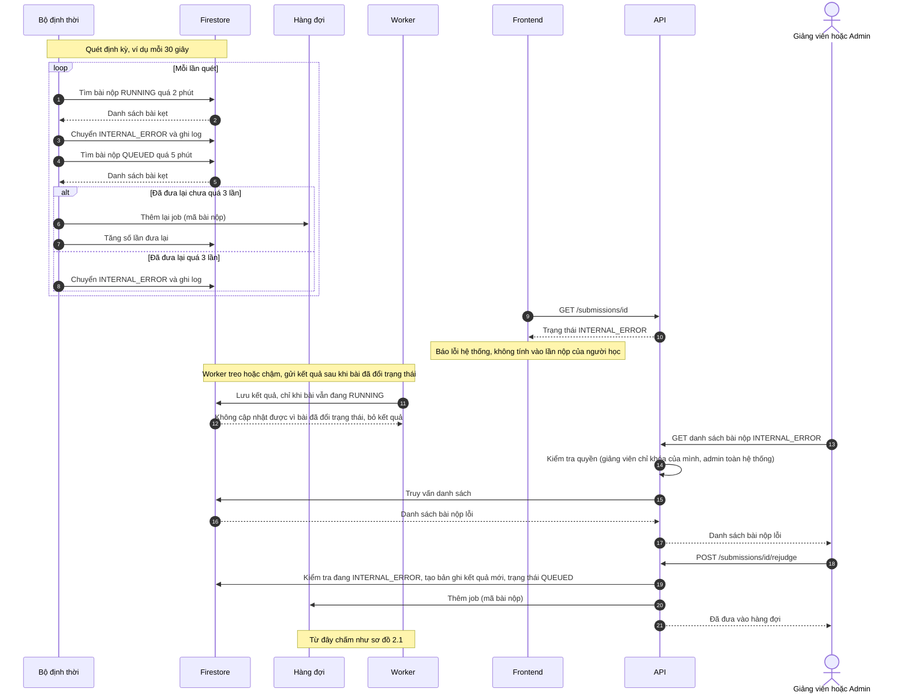

| Bước | Hành động | Ràng buộc liên quan |
|---|---|---|
| 1–3 | Bài `RUNNING` quá 2 phút chuyển `INTERNAL_ERROR` | §3.3, UC-26, AC-23 |
| 4–8 | Bài `QUEUED` quá 5 phút được đưa lại hàng đợi, tối đa 3 lần, vượt quá thì `INTERNAL_ERROR` | §3.3, UC-26, AC-23 |
| 9–10 | Giao diện báo lỗi hệ thống, bài không tính vào lần nộp | §3.3, UC-09 (5c) |
| 11–12 | Kết quả đến muộn bị bỏ qua nhờ điều kiện trạng thái khi lưu | §3.3, BR-11 |
| 13–21 | Chấm lại tạo bản ghi kết quả mới, ghi nhận người thực hiện | UC-19, BR-07, BR-11, FR-32 |

### 2.3 Điểm thiết kế cần xác nhận

1. **Cập nhật kết quả bằng polling.** §3.3 cho phép polling hoặc SSE/WebSocket. Sơ đồ dùng polling vì đơn giản; chuyển sang SSE chỉ thay vòng lặp ở khối giao diện, không đổi phần còn lại.
2. **Tạo bài nộp rồi mới đưa vào hàng đợi, không nguyên tử.** Nếu API lỗi giữa hai bước, bài nộp nằm ở `QUEUED` mà không có job, và chỉ được đưa lại sau 5 phút nhờ UC-26. Chấp nhận độ trễ này, hay dùng outbox, hay trả lỗi ngay cho người học khi đưa vào hàng đợi thất bại?
3. **Chạy hết test case.** Điểm bằng tổng trọng số test đạt nên worker chạy toàn bộ test, chỉ dừng khi biên dịch lỗi hoặc hạ tầng lỗi. Với bài nhiều test, thời gian chấm tăng theo số test (liên quan NFR-10).
4. **Biên dịch lặp lại.** Mỗi test chạy trong sandbox riêng (§3.3) và UC-27 biên dịch trong từng lần chạy. Biên dịch một lần rồi dùng lại là tối ưu triển khai, không đổi hành vi. Nên gắn với quyết định Judge0 hay runner tự xây (câu hỏi mở 1).
5. **Số lần đưa lại.** Bộ định thời cần đếm số lần đưa lại cho mỗi bài `QUEUED`. Requirements chưa quy định chỗ lưu (trường riêng trong document bài nộp hay dùng bộ đếm retry của BullMQ), cần chốt khi thiết kế mô hình dữ liệu.
6. **Chỉ mục và giới hạn của Firestore.** Truy vấn của bộ định thời (trạng thái cộng thời điểm cập nhật) và thống kê cần chỉ mục tổng hợp. Kết quả từng test lưu thành mảng trong một document thì bị giới hạn 1 MiB mỗi document; lưu thành subcollection thì mỗi test một document, ghi và đọc được từng test nhưng chấm một bài phải đọc nhiều document hơn. Cần chọn khi thiết kế mô hình dữ liệu.

---

## 3. UC-11 — Làm bài đánh giá

Bài đánh giá gồm câu trắc nghiệm (chấm ngay) và bài code (chấm qua hàng đợi như UC-09). Mọi mốc thời gian do **đồng hồ máy chủ** quyết định (BR-15). Phần chấm code dùng lại luồng worker và sandbox ở mục 2.1 nên không vẽ lại chi tiết.

### 3.1 Bắt đầu, tiếp tục và làm bài

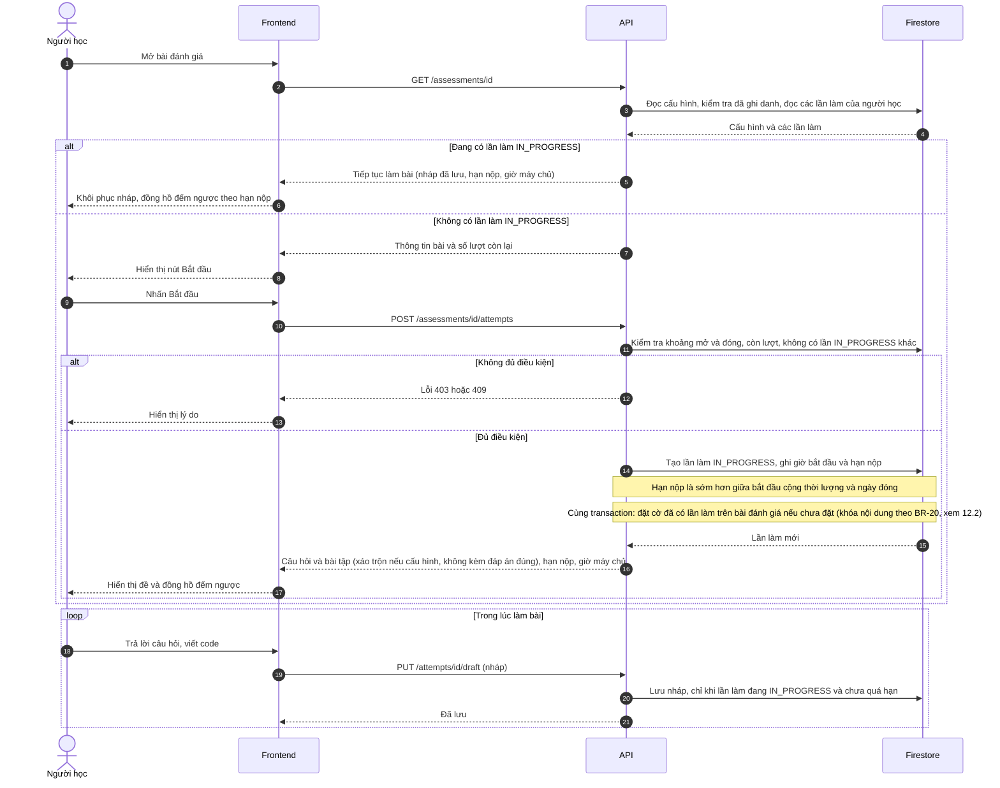

| Bước | Hành động | Ràng buộc liên quan |
|---|---|---|
| 1–4 | Mở bài, đọc cấu hình, kiểm tra đã ghi danh | FR-33, BR-05 |
| 5–6 | Đang có lần làm `IN_PROGRESS` thì tiếp tục: khôi phục nháp, đồng hồ theo giờ máy chủ | UC-11 (luồng tiếp tục), §3.4, BR-15 |
| 7–13 | Bắt đầu lần làm mới, từ chối nếu ngoài khoảng mở/đóng, hết lượt hoặc đang có lần `IN_PROGRESS` | BR-16, AC-27, UC-11 (1a, 1b) |
| 14–17 | Tạo lần làm, hạn nộp là sớm hơn giữa bắt đầu cộng thời lượng và ngày đóng; trả đề không kèm đáp án đúng | §3.4, BR-09, BR-15, AC-25 |
| 18–21 | Tự lưu nháp định kỳ, chỉ khi còn hạn | FR-33, BR-15, AC-26 |

### 3.2 Nộp bài và chấm

Người học nộp, hệ thống chấm trắc nghiệm ngay rồi đưa phần code vào hàng đợi. Lần làm chỉ chuyển `GRADED` khi mọi phần đã chấm.

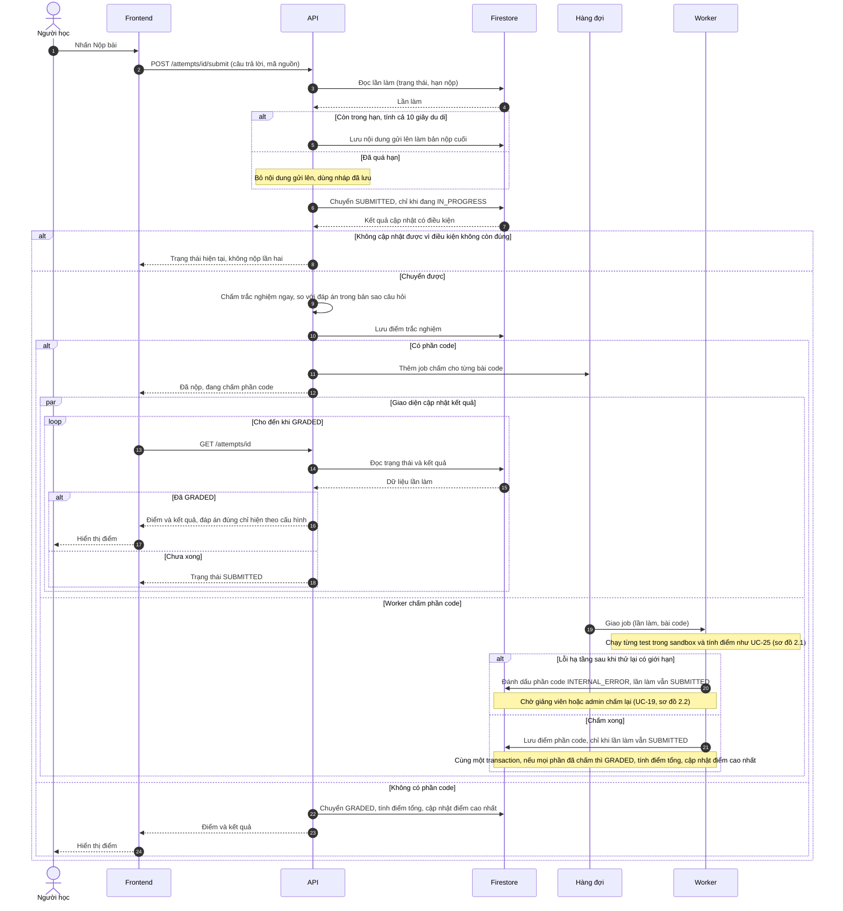

| Bước | Hành động | Ràng buộc liên quan |
|---|---|---|
| 1–4 | Người học nộp, API đọc trạng thái và hạn nộp của lần làm | FR-33, BR-15 |
| 5 | Còn trong hạn (cộng 10 giây du di) thì dùng nội dung gửi lên; quá hạn thì bỏ nội dung và dùng nháp đã lưu | BR-15, AC-26, UC-11 (4a) |
| 6–8 | Chuyển `SUBMITTED` chỉ khi đang `IN_PROGRESS`, nên nộp lần hai không có hiệu lực | UC-11 (4b), §3.4 |
| 9–10 | Chấm trắc nghiệm ngay, điểm do máy chủ tính | FR-34, BR-08, BR-18 |
| 11–12 | Phần code đưa vào hàng đợi, người học thấy đã nộp | FR-34, UC-25 |
| 13–18 | Giao diện cập nhật đến khi `GRADED`; đáp án đúng chỉ hiện theo cấu hình | BR-17, AC-28 |
| 19–21 | Worker chấm phần code; lỗi hạ tầng thì phần code `INTERNAL_ERROR`, lần làm vẫn `SUBMITTED` chờ chấm lại; chấm xong thì lưu điểm, kiểm tra mọi phần, chuyển `GRADED`, cập nhật điểm cao nhất | §3.4, BR-11, BR-19, AC-23, AC-40, NFR-12 |
| 22–24 | Không có phần code thì chuyển `GRADED` ngay | §3.4, BR-19 |

### 3.3 Hết giờ: tự nộp và nộp trùng thời điểm

Bộ định thời tự nộp các lần làm quá hạn (UC-26). Nếu người học cũng nộp đúng lúc đó, chỉ một bên thành công vì cả hai dùng cùng điều kiện trạng thái (UC-11, luồng 4b).

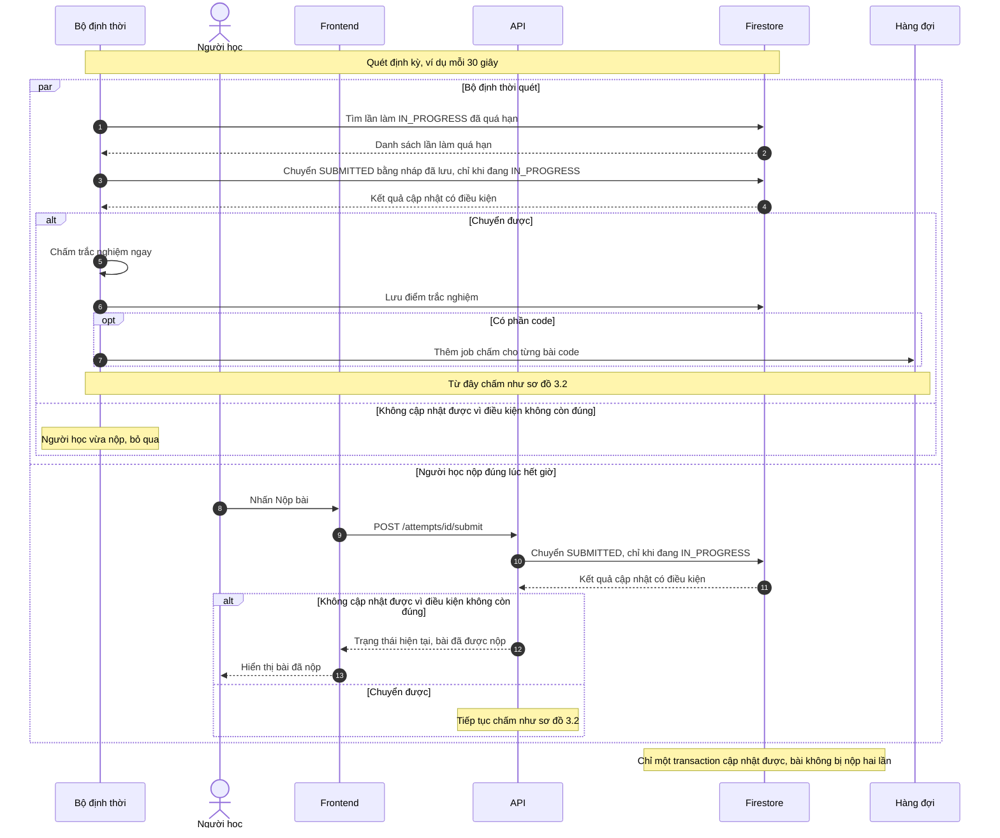

| Bước | Hành động | Ràng buộc liên quan |
|---|---|---|
| 1–4 | Bộ định thời tìm lần làm quá hạn và chuyển `SUBMITTED` bằng nháp đã lưu, chỉ khi đang `IN_PROGRESS` | UC-26, BR-15, AC-25 |
| 5–7 | Chấm trắc nghiệm, đưa phần code vào hàng đợi | UC-26, UC-25 |
| 8–13 | Người học nộp cùng lúc: bên đến sau không cập nhật được vì trạng thái đã đổi nên không nộp hai lần | UC-11 (4b), UC-26 (2a), NFR-11 |

### 3.4 Điểm thiết kế cần xác nhận

1. **Quay lại sau khi hết hạn nhưng trước lần quét của bộ định thời.** Máy chủ quyết định thời gian (BR-15), nên API cần nộp bằng nháp đã lưu thay vì cho tiếp tục làm bài. UC-11 chưa nêu rõ trường hợp này.
2. **Ai chuyển `GRADED`.** Nếu không có phần code, API chuyển ngay. Nếu có, worker xử lý phần code sau cùng sẽ chuyển trong cùng transaction với việc lưu điểm. Cách khác là để bộ định thời quét các lần làm `SUBMITTED` đã chấm đủ, nhưng thêm độ trễ.
3. **Một lần làm `IN_PROGRESS` cho mỗi cặp người học và bài đánh giá.** Để hai tab bấm Bắt đầu cùng lúc không tạo hai lần làm, cần đảm bảo duy nhất ở tầng dữ liệu. Firestore không có ràng buộc duy nhất một phần theo trạng thái, nên dùng một document khóa có ID xác định (ví dụ `{userId}_{assessmentId}`), tạo bằng `create()` khi bắt đầu và xóa khi nộp, hoặc kiểm tra trong cùng transaction. NFR-13 chưa liệt kê trường hợp này.
4. **Lưu nháp sau hạn.** BR-15 chỉ nói về nội dung nộp. Sơ đồ giả định nháp gửi sau hạn (cộng 10 giây du di) cũng bị bỏ qua.
5. **Chấm trắc nghiệm đồng bộ.** API và bộ định thời chấm ngay vì chỉ so khớp đáp án. Nếu bài rất nhiều câu có thể chuyển sang worker mà không đổi hành vi.
6. **Kết quả phần code không vào lịch sử bài nộp (BR-19).** Worker dùng lại luồng UC-25 nhưng ghi kết quả theo lần làm. Khi thiết kế mô hình dữ liệu cần tách collection kết quả hoặc đánh dấu nguồn của kết quả.
7. **Lần làm bị bỏ dở có tính lượt không.** Requirements chưa nói. Sơ đồ coi mọi lần làm đã bắt đầu là đã dùng một lượt, kể cả khi bị tự nộp lúc hết giờ. Cần chốt, vì ảnh hưởng đến BR-16.

---

## 4. UC-01, UC-02 — Đăng ký, đăng nhập và quản lý phiên

Cơ chế token theo NFR-05: access token ngắn hạn (khoảng 15 phút) gửi kèm mỗi yêu cầu, refresh token nằm trong cookie `httpOnly` và bị thu hồi khi đăng xuất. Máy chủ kiểm tra cờ `isActive` ở mỗi yêu cầu.

### 4.1 Đăng ký tài khoản

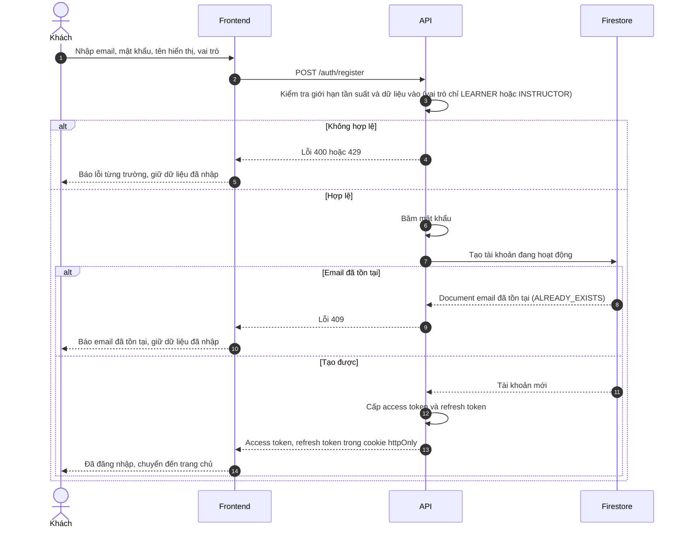

| Bước | Hành động | Ràng buộc liên quan |
|---|---|---|
| 1–5 | Kiểm tra tần suất và dữ liệu vào; chỉ nhận vai trò `LEARNER` hoặc `INSTRUCTOR`, từ chối `ADMIN` | UC-01 (3b, 3c), NFR-03, NFR-06, AC-31 |
| 6–10 | Băm mật khẩu, tạo tài khoản; email trùng bị chặn, giữ lại dữ liệu đã nhập | UC-01 (3a), NFR-01, NFR-13 |
| 11–14 | Cấp phiên và đăng nhập luôn sau khi đăng ký | UC-01 (5), NFR-05 |

### 4.2 Đăng nhập

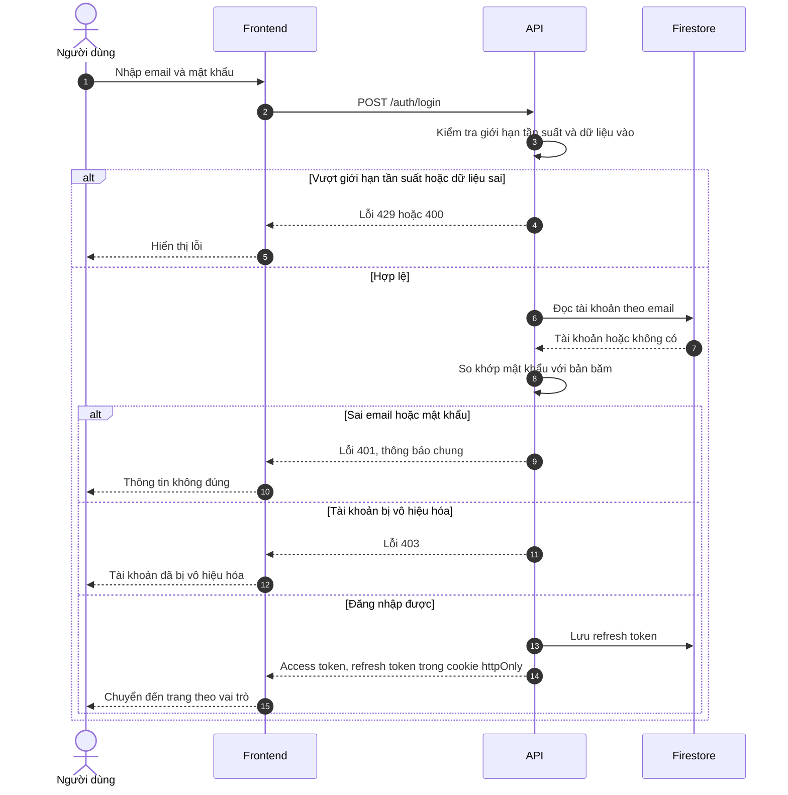

| Bước | Hành động | Ràng buộc liên quan |
|---|---|---|
| 1–5 | Kiểm tra giới hạn tần suất và dữ liệu vào | UC-02 (2c), NFR-03, NFR-06 |
| 6–10 | Sai email hoặc sai mật khẩu đều trả cùng một thông báo, không tiết lộ email có tồn tại | UC-02 (2a) |
| 11–12 | Tài khoản bị vô hiệu hóa không đăng nhập được | UC-02 (2b), AC-30 |
| 13–15 | Cấp phiên, chuyển đến trang theo vai trò | UC-02 (3, 4), NFR-05 |

### 4.3 Xác thực mỗi yêu cầu và làm mới phiên

Áp dụng cho mọi yêu cầu cần đăng nhập ở các sơ đồ khác. Các sơ đồ đó chỉ ghi bước "Xác thực" và không vẽ lại luồng này.

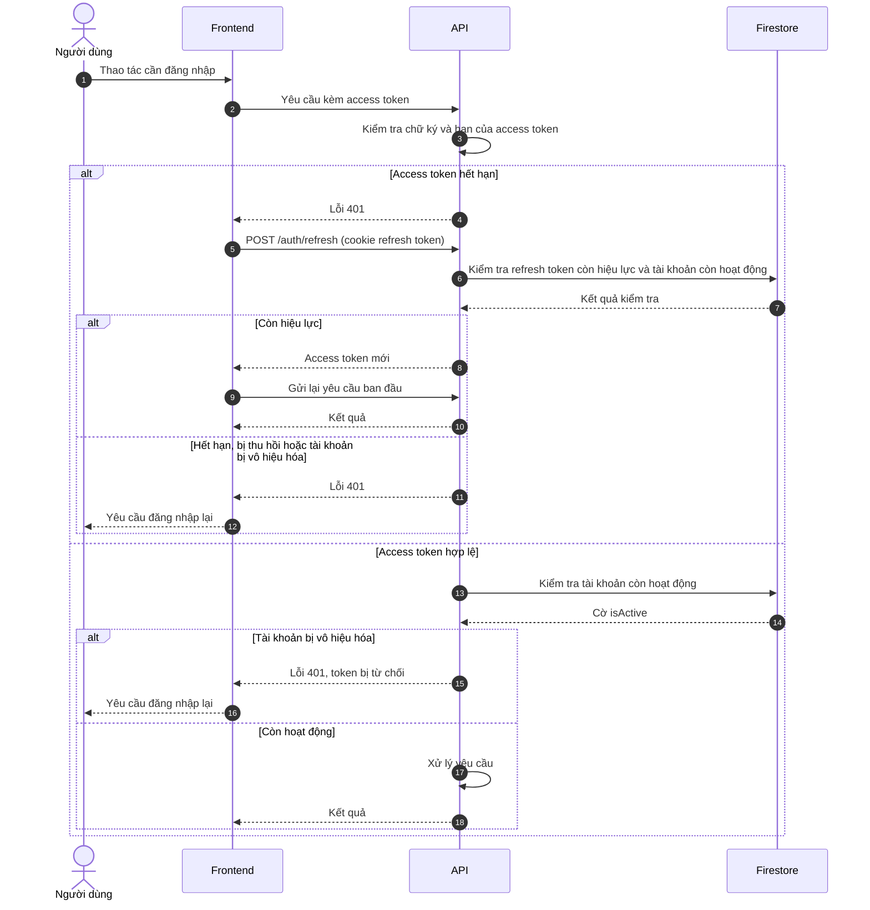

| Bước | Hành động | Ràng buộc liên quan |
|---|---|---|
| 1–3 | Kiểm tra access token ở mỗi yêu cầu | NFR-05 |
| 4–12 | Access token hết hạn thì làm mới bằng refresh token; không làm mới được thì yêu cầu đăng nhập lại | UC-02 (ngoại lệ phiên hết hạn), NFR-05 |
| 13–16 | Kiểm tra cờ `isActive` ở mỗi yêu cầu, token của tài khoản bị vô hiệu hóa bị từ chối | NFR-05, AC-30, UC-22 (3) |
| 17–18 | Xử lý yêu cầu bình thường | — |

### 4.4 Đăng xuất

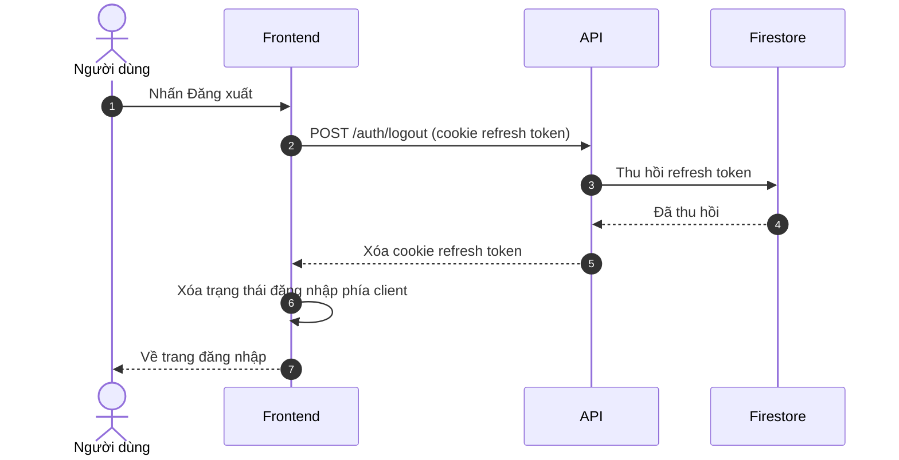

| Bước | Hành động | Ràng buộc liên quan |
|---|---|---|
| 1–7 | Thu hồi refresh token, xóa cookie và trạng thái đăng nhập phía client | UC-02 (5), NFR-05, AC-41 |

### 4.5 Điểm thiết kế cần xác nhận

1. **Email trùng.** Sơ đồ dựa vào việc tạo document có ID xác định (document theo email đã chuẩn hóa, ghi cùng document người dùng trong một transaction hoặc batch) thay vì kiểm tra rồi mới tạo, để hai yêu cầu đồng thời không tạo hai tài khoản. NFR-13 đã nêu cách này. Mã lỗi 409 chỉ để minh họa.
2. **Thứ tự kiểm tra khi đăng nhập.** Chỉ báo "tài khoản bị vô hiệu hóa" sau khi mật khẩu đã đúng, để người lạ không dò được email nào tồn tại (UC-02, 2a). Vì vậy sơ đồ so khớp mật khẩu trước khi xét `isActive`.
3. **Nơi lưu refresh token.** Muốn thu hồi khi đăng xuất thì máy chủ phải lưu refresh token (hoặc bản băm của nó). NFR-05 chưa nói lưu ở Firestore hay Redis, và chưa nói có xoay vòng token mỗi lần làm mới hay không. Sơ đồ ghi Firestore cho đơn giản (document có ID là bản băm của token, kèm hạn dùng).
4. **Kiểm tra `isActive` mỗi yêu cầu.** Mỗi yêu cầu cần thêm một lượt đọc Firestore (tính phí theo lượt đọc). Có thể đệm kết quả ngắn hạn để giảm tải, nhưng khi đó việc vô hiệu hóa (UC-22) có hiệu lực chậm hơn "từ yêu cầu kế tiếp" mà AC-30 yêu cầu.

---

## 5. UC-08 — Chạy thử code

Chạy thử dùng chung sandbox với chấm bài (UC-27) nhưng **không** tạo bài nộp, không qua hàng đợi chấm, không đổi điểm hay tiến độ. Người học thấy kết quả ngay trong cùng phản hồi.

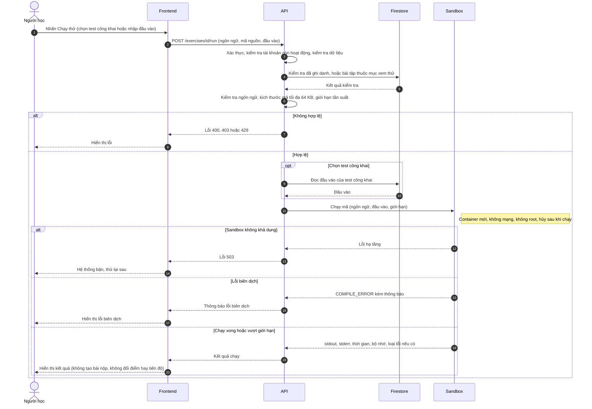

| Bước | Hành động | Ràng buộc liên quan |
|---|---|---|
| 1–6 | Kiểm tra xác thực, quyền (đã ghi danh hoặc mục xem thử), dữ liệu vào, ngôn ngữ, kích thước mã, tần suất | UC-08 (3), BR-05, BR-13, BR-14, NFR-06 |
| 7–8 | Từ chối khi mã quá 64 KB, ngôn ngữ không bật hoặc vượt tần suất | UC-08 (3a, 3b), BR-13, BR-14 |
| 9–10 | Chỉ đọc đầu vào của test công khai | BR-09 |
| 11 | Chạy trong sandbox, không bao giờ trong tiến trình của API | BR-10, UC-27, AC-18 |
| 12–14 | Sandbox không khả dụng thì báo hệ thống bận | UC-08 (4c), UC-27 (4b) |
| 15–17 | Lỗi biên dịch hiển thị thông báo lỗi | UC-08 (4a), AC-16 |
| 18–20 | Trả stdout, stderr, thời gian, bộ nhớ và loại lỗi (quá thời gian, quá bộ nhớ); không tạo bài nộp | UC-08 (4b, 5), AC-12, AC-17 |

### 5.1 Điểm thiết kế cần xác nhận

1. **Chạy đồng bộ hay qua hàng đợi.** UC-08 yêu cầu trả kết quả ngay nên sơ đồ để API gọi sandbox và chờ. Khi nhiều người chạy thử cùng lúc, chúng tranh tài nguyên sandbox với worker chấm bài. Cần giới hạn số lần chạy song song, hoặc tách nhóm runner riêng cho chạy thử để không làm chậm chấm bài.
2. **Đầu vào tùy chọn.** Requirements giới hạn mã nguồn 64 KB (BR-13) nhưng chưa giới hạn kích thước đầu vào tự nhập. Cần đặt giới hạn để tránh lạm dụng.
3. **Nháp tự lưu.** UC-08 (bước 1) nói nháp được tự lưu nhưng chưa quy định lưu ở đâu (CSDL hay trình duyệt) và có chung với nháp của bài nộp hay không. Sơ đồ không vẽ phần này.
4. **Test ẩn không chạy thử được.** Đường chạy thử chỉ đọc test công khai (BR-09). Nếu sau này cho chọn test theo mã, API phải kiểm tra test đó là công khai.

---

## 6. UC-17, UC-28, UC-20 — Gửi duyệt và kiểm duyệt khóa học

Vòng đời khóa học theo §3.2 và `state-diagrams.md`: giảng viên gửi duyệt (`DRAFT` hoặc `REJECTED` sang `PENDING_REVIEW`), rồi admin duyệt (`PUBLISHED`) hoặc từ chối (`REJECTED`, kèm lý do).

### 6.1 Giảng viên gửi duyệt

Phần kiểm tra điều kiện gửi duyệt (UC-28) là bước nội bộ, nên được vẽ trong cùng sơ đồ.

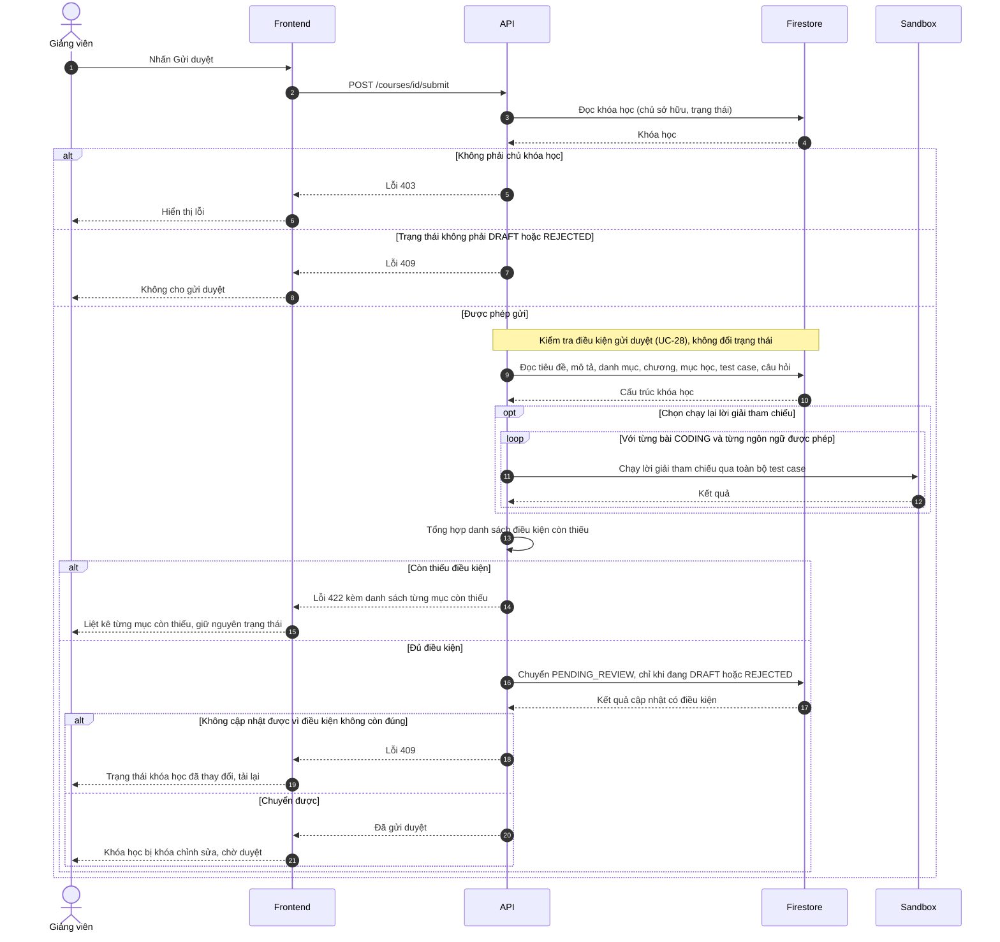

| Bước | Hành động | Ràng buộc liên quan |
|---|---|---|
| 1–4 | Đọc khóa học, kiểm tra quyền sở hữu | BR-02, AC-05 |
| 5–8 | Từ chối khi không phải chủ khóa học hoặc trạng thái không cho gửi (`PENDING_REVIEW`, `PUBLISHED`, `ARCHIVED`) | UC-17 (1a), §3.2 |
| 9–10 | Đọc dữ liệu để kiểm tra điều kiện gửi duyệt (UC-28): thông tin khóa, chương và mục, test ẩn của bài CODING, câu hỏi QUIZ | UC-28 (1–3, 5), BR-02, §3.2 |
| 11–12 | Chạy lại lời giải tham chiếu qua UC-27 (phương án chưa chốt) | UC-28 (4), requirements §10 câu 8 |
| 13 | Tổng hợp mọi điều kiện còn thiếu thay vì dừng ở mục đầu tiên | UC-28 (1a–5a) |
| 14–15 | Thiếu điều kiện thì liệt kê từng mục, giữ nguyên trạng thái | UC-17 (2a), AC-06 |
| 16–19 | Chuyển `PENDING_REVIEW` chỉ khi đang `DRAFT` hoặc `REJECTED`, nên không gửi hai lần | UC-17 (3), §3.2, AC-04 |
| 20–21 | Khóa học bị khóa chỉnh sửa, chờ admin duyệt | UC-17 (hậu điều kiện), BR-02 |

### 6.2 Admin duyệt hoặc từ chối

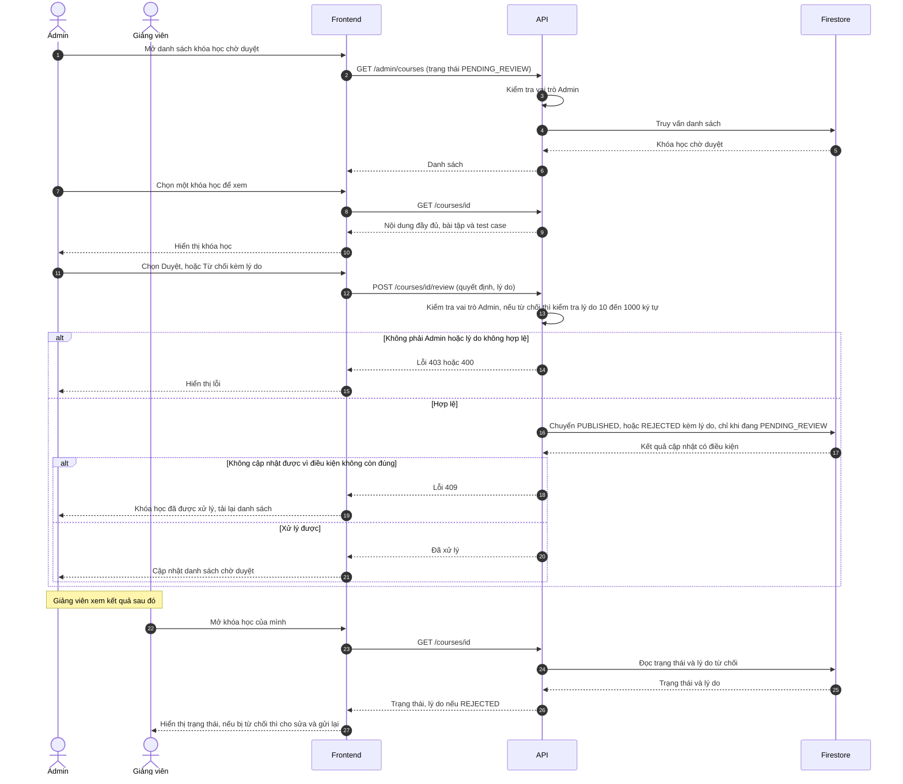

| Bước | Hành động | Ràng buộc liên quan |
|---|---|---|
| 1–10 | Admin mở danh sách chờ duyệt và xem toàn bộ nội dung, bài tập, test case | UC-20 (1, 2), BR-05, AC-45 |
| 11–15 | Chỉ admin được duyệt hoặc từ chối; lý do từ chối dài 10–1000 ký tự | BR-03, UC-20 (3b), AC-08 |
| 16–19 | Chuyển `PUBLISHED` hoặc `REJECTED` chỉ khi đang `PENDING_REVIEW`; admin đến sau nhận xung đột | UC-20 (3, 3a, 3c), AC-07 |
| 20–21 | Cập nhật danh sách chờ duyệt | UC-20 |
| 22–27 | Giảng viên xem trạng thái và lý do từ chối, sửa rồi gửi lại | UC-20 (3a), AC-07 |

### 6.3 Điểm thiết kế cần xác nhận

1. **Kiểm tra và chuyển trạng thái không nguyên tử.** Giữa lúc kiểm tra điều kiện và lúc chuyển `PENDING_REVIEW`, giảng viên vẫn sửa được khóa học (ví dụ từ tab khác) nên có thể xóa đi thứ vừa được kiểm tra. Cần kiểm tra lại trong cùng transaction với việc chuyển trạng thái, hoặc dùng trường phiên bản để phát hiện thay đổi. Điều kiện trạng thái ở bước chuyển chỉ chặn gửi hai lần, không chặn sửa xen giữa.
2. **Chạy lại lời giải tham chiếu hay dùng kết quả đã lưu** (câu hỏi mở số 8 ở requirements §10). Sơ đồ vẽ phương án chạy lại trong khối `opt`. Phương án này tốn thời gian theo số bài, số ngôn ngữ và số test, nên dễ quá thời gian chờ của một yêu cầu HTTP đồng bộ. Phương án dùng kết quả kiểm chứng đã lưu thì bỏ khối này, nhưng cần đánh dấu kết quả hết hiệu lực khi test case hoặc lời giải thay đổi.
3. **Một endpoint duyệt và từ chối.** Sơ đồ gộp hai thao tác để ngắn gọn. Khi viết đặc tả API có thể tách thành hai endpoint, miễn cùng dùng điều kiện trạng thái `PENDING_REVIEW` để hai admin xử lý đồng thời không ghi đè nhau (UC-20, 3c).
4. **Admin xem toàn bộ nội dung** gồm cả test ẩn (BR-05, AC-45), vì cần đánh giá chất lượng bài tập trước khi duyệt. Điều này khác với người học, không bao giờ nhận dữ liệu test ẩn (BR-09).

---

## 7. UC-29 — Làm mục học QUIZ

Khác với bài đánh giá (UC-11), mục QUIZ để luyện tập: chấm ngay, làm lại không giới hạn, và được hiện đáp án đúng sau khi nộp (ngoại lệ của BR-09 dành cho mục QUIZ). Không có hạn nộp và không cần hàng đợi.

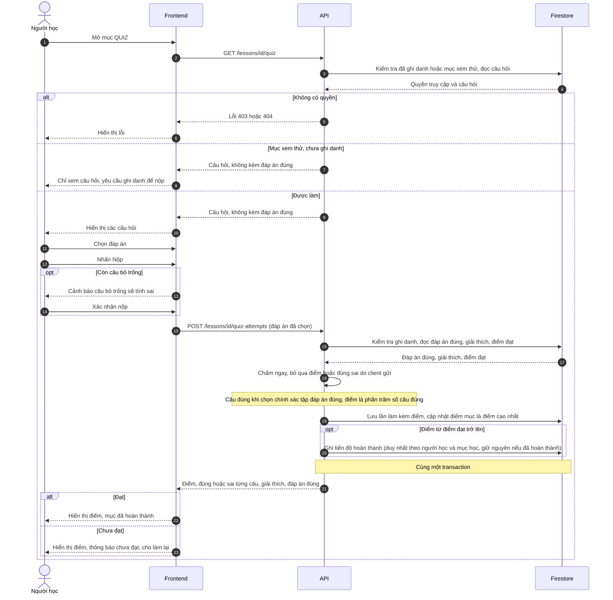

| Bước | Hành động | Ràng buộc liên quan |
|---|---|---|
| 1–4 | Kiểm tra quyền truy cập theo ID mục (ghi danh hoặc xem thử) | UC-29 (tiền điều kiện), BR-05 |
| 5–6 | Không có quyền thì từ chối, không trả nội dung | UC-07 (3a, 3b), BR-05 |
| 7–8 | Mục xem thử: chưa ghi danh chỉ xem câu hỏi, không nộp được | UC-29 (2a) |
| 9–10 | Trả câu hỏi, không kèm đáp án đúng | BR-09, UC-29 (2) |
| 11–14 | Chọn đáp án và nộp; câu bỏ trống vẫn cho nộp sau khi cảnh báo | UC-29 (3, 4, 4a) |
| 15–17 | Gửi đáp án đã chọn, máy chủ kiểm tra ghi danh và đọc đáp án đúng | BR-05, UC-29 (5) |
| 18 | Máy chủ chấm ngay, bỏ qua điểm và đúng sai do client gửi; câu đúng khi chọn chính xác tập đáp án đúng, điểm bằng phần trăm số câu đúng, không chấm từng phần | BR-08, BR-18, AC-36, UC-29 (5a) |
| 19–20 | Lưu lần làm và điểm cao nhất của mục; nếu đạt thì đánh dấu hoàn thành (duy nhất theo người học và mục học), lần sau điểm thấp hơn không làm mất hoàn thành; tất cả trong một transaction | UC-29 (7, 7a), BR-12, NFR-12, NFR-13, §3.5, AC-37 |
| 21–23 | Hiển thị điểm, đúng hoặc sai từng câu, giải thích và đáp án đúng; chưa đạt thì cho làm lại | UC-29 (6, 6a), BR-09 (ngoại lệ QUIZ) |

### 7.1 Điểm thiết kế cần xác nhận

1. **Điểm của mục.** Điểm của mục là điểm cao nhất các lần làm. Requirements chưa nói lưu thành trường riêng trong document tiến độ hay tính khi đọc. Lưu riêng thì đọc nhanh nhưng phải cập nhật trong cùng transaction, như sơ đồ.
2. **Sửa câu hỏi sau khi người học đã làm.** Giảng viên sửa câu hỏi thì điểm và trạng thái hoàn thành cũ được giữ nguyên (UC-29, ngoại lệ cuối). Để lịch sử lần làm vẫn hiển thị đúng, mỗi lần làm nên lưu kèm nội dung câu hỏi và đáp án đã chọn, hoặc câu hỏi được lưu theo phiên bản. Cần chốt khi thiết kế mô hình dữ liệu.
3. **Chấm đồng bộ trong API.** Chấm trắc nghiệm chỉ so khớp đáp án nên không qua worker. Nếu mục có rất nhiều câu thì có thể chuyển sang worker mà không đổi hành vi (cùng nhận xét ở 3.4).
4. **Tiến độ không tạo trùng.** Document tiến độ có ID xác định `{người học}_{mục học}` (NFR-13) nên hai lần nộp đồng thời không tạo hai bản ghi tiến độ. Thao tác ghi là "tạo nếu chưa có" (`create()`, hoặc đọc rồi ghi trong transaction), không ghi đè trạng thái đã hoàn thành.

---

## 8. UC-06 — Ghi danh và hủy ghi danh khóa học

Ghi danh là một document có ID xác định từ người học và khóa học, nên không thể có hai ghi danh trùng nhau (BR-04, NFR-13). Hủy ghi danh chỉ xóa document này, tiến độ và bài nộp được giữ lại (§3.5).

### 8.1 Ghi danh

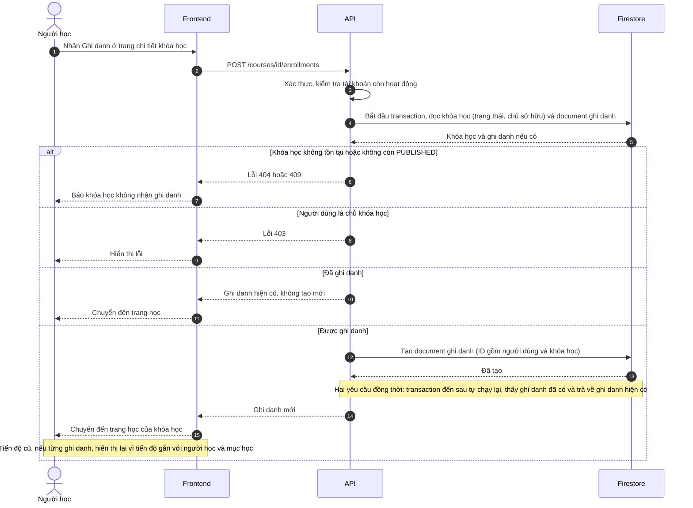

| Bước | Hành động | Ràng buộc liên quan |
|---|---|---|
| 1–5 | Xác thực, đọc khóa học và ghi danh trong transaction | FR-23, BR-04 |
| 6–7 | Khóa học không tồn tại hoặc không còn `PUBLISHED` thì từ chối | UC-06 (2a), BR-01, AC-02 |
| 8–9 | Chủ khóa học không ghi danh được khóa của mình | UC-06 (2b), AC-10 |
| 10–11 | Đã ghi danh, kể cả yêu cầu đồng thời, thì trả về ghi danh hiện có | UC-06 (3a), BR-04, NFR-13, AC-09 |
| 12–15 | Tạo ghi danh, chuyển đến trang học; tiến độ cũ hiển thị lại | UC-06 (3, 4), FR-23, §3.5 |

### 8.2 Hủy ghi danh

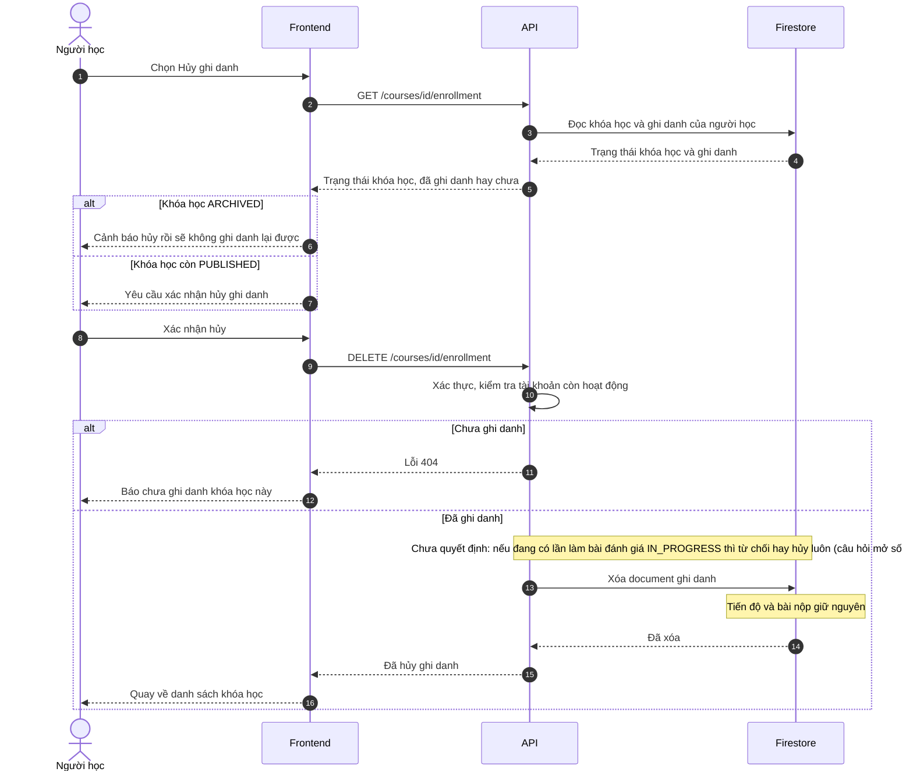

| Bước | Hành động | Ràng buộc liên quan |
|---|---|---|
| 1–7 | Lấy trạng thái khóa học; khóa `ARCHIVED` thì cảnh báo không ghi danh lại được | UC-06 (H1, H2), BR-06, §3.5 |
| 8–12 | Xác nhận hủy; chưa ghi danh thì 404 | UC-06 (H2) |
| 13–16 | Xóa ghi danh, giữ tiến độ và bài nộp; cách xử lý lần làm `IN_PROGRESS` chưa quyết định | UC-06 (H3, H2a), FR-23, §3.5, requirements §10 câu 7 |

### 8.3 Điểm thiết kế cần xác nhận

1. **Mã lỗi khi khóa học không nhận ghi danh.** UC-06 (2a) chỉ nói báo lỗi. Khóa chưa từng xuất bản nên trả 404 để không lộ sự tồn tại (AC-02), còn khóa `ARCHIVED` thì 409 kèm thông báo rõ. Sơ đồ gộp hai mã để gọn.
2. **Hủy ghi danh khi đang có lần làm `IN_PROGRESS`** (UC-06 H2a, câu hỏi mở số 7 ở requirements §10). Nếu chọn hủy luôn lần làm thì việc xóa ghi danh và đóng lần làm phải nằm trong cùng một transaction.
3. **Danh sách khóa học đã ghi danh và số ghi danh của khóa.** Firestore không có JOIN. Danh sách "khóa học của tôi" truy vấn ghi danh theo người học rồi đọc từng khóa. Số ghi danh theo khóa dùng truy vấn đếm theo khóa học, cần chỉ mục khi kết hợp thêm điều kiện (UC-18, FR-22).
4. **Ghi danh lại khôi phục tiến độ.** Hủy ghi danh tuyệt đối không được xóa document tiến độ. Thao tác xóa trong sơ đồ chỉ chạm vào document ghi danh.

---

## 9. UC-07 — Học nội dung và đánh dấu hoàn thành

Quyền truy cập luôn kiểm tra theo ID mục học trên máy chủ (BR-05). Phần trăm tiến độ tính theo §3.5: số mục hoàn thành chia tổng số mục hiện có, làm tròn xuống.

### 9.1 Mở đề cương và mở một mục học

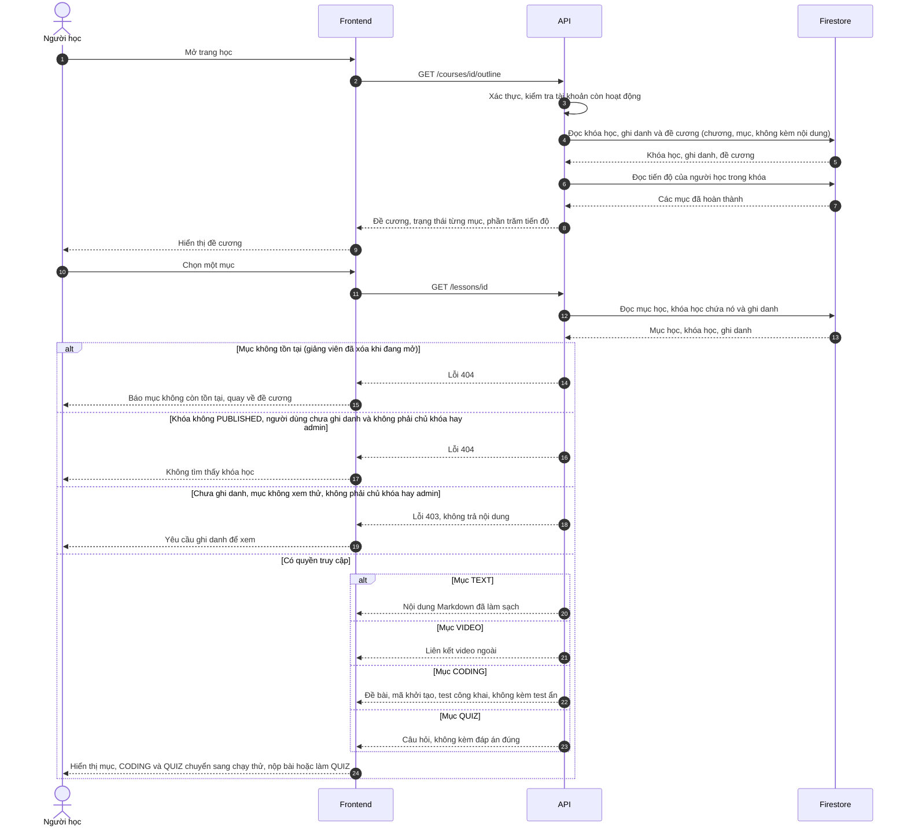

| Bước | Hành động | Ràng buộc liên quan |
|---|---|---|
| 1–9 | Đọc đề cương kèm trạng thái hoàn thành và phần trăm tiến độ | UC-07 (1), FR-24, FR-25, §3.5 |
| 10–13 | Chọn mục, kiểm tra quyền theo ID mục học | UC-07 (2, 3), BR-05 |
| 14–15 | Mục đã bị giảng viên xóa khi đang mở thì quay về đề cương | UC-07 (4a) |
| 16–17 | Khóa không `PUBLISHED` và chưa ghi danh thì 404, không lộ sự tồn tại | UC-07 (3b), AC-02 |
| 18–19 | Chưa ghi danh và mục không xem thử thì 403, không trả nội dung | UC-07 (3a), BR-05, AC-01, AC-11 |
| 20–24 | Hiển thị theo loại mục; CODING không kèm test ẩn, QUIZ không kèm đáp án đúng | UC-07 (4), BR-09, NFR-08 |

### 9.2 Đánh dấu hoàn thành

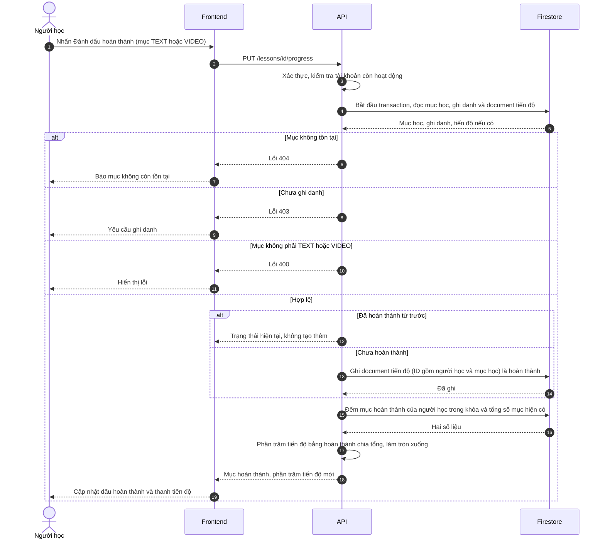

| Bước | Hành động | Ràng buộc liên quan |
|---|---|---|
| 1–5 | Xác thực, đọc mục học, ghi danh và tiến độ trong transaction | UC-07 (5), BR-05 |
| 6–7 | Mục không tồn tại | UC-07 (4a) |
| 8–9 | Chưa ghi danh | UC-07 (3a), BR-05 |
| 10–11 | Mục CODING và QUIZ không đánh dấu thủ công, hoàn thành theo bài nộp hoặc điểm | FR-25, §3.5 |
| 12 | Đánh dấu lặp lại không tạo thêm bản ghi | UC-07 (5a) |
| 13–14 | Ghi tiến độ theo người học và mục học, không tạo trùng | UC-07 (6), NFR-13, §3.5 |
| 15–19 | Tính lại phần trăm tiến độ theo tổng số mục hiện có | UC-07 (6a), §3.5, AC-24 |

### 9.3 Điểm thiết kế cần xác nhận

1. **Phần trăm tiến độ tính khi đọc.** Sơ đồ đếm bằng truy vấn đếm của Firestore mỗi lần cần, không lưu sẵn. Khóa nhiều mục và nhiều người học thì tốn lượt đọc; có thể lưu sẵn `completedCount` trong document ghi danh và cập nhật cùng transaction, đổi lại phải xử lý khi giảng viên thêm hoặc xóa mục (UC-07 6a).
2. **Xóa mục học để lại tiến độ mồ côi.** Firestore không có xóa dây chuyền. Khi giảng viên xóa mục (UC-14), phải xóa luôn các document tiến độ của mục đó, nếu không phần trăm bị đếm thừa. Có thể hàng trăm document, nên xóa theo lô (BulkWriter) thay vì một transaction dài, vì mỗi transaction tối đa 270 giây.
3. **Mục xem thử khi chưa ghi danh có lưu tiến độ không.** UC-07 cho phép xem nhưng requirements chưa nói. Sơ đồ giả định chỉ người đã ghi danh mới đánh dấu hoàn thành (bước 403).
4. **403 và 404 không được lộ sự tồn tại** của khóa học chưa xuất bản (UC-07 3a, 3b; AC-02). Thứ tự kiểm tra trong sơ đồ phải giữ nguyên.
5. **Test ẩn không bao giờ vào phản hồi mục CODING** (BR-09). Nên lưu test ẩn và lời giải tham chiếu ở collection riêng mà đường đọc của người học không bao giờ chạm tới, thay vì lọc trường sau khi đọc, để một lần quên lọc không làm lộ dữ liệu.

---

## 10. UC-15 — Tạo bài tập code và test case

Luồng của giảng viên gồm lưu bài tập (10.1) và kiểm tra lời giải tham chiếu bằng sandbox (10.2, UC-27). Quy tắc chặn ở khóa `PUBLISHED` (AC-43) dựa vào kết quả kiểm tra, nên hai sơ đồ liên quan với nhau.

### 10.1 Lưu bài tập

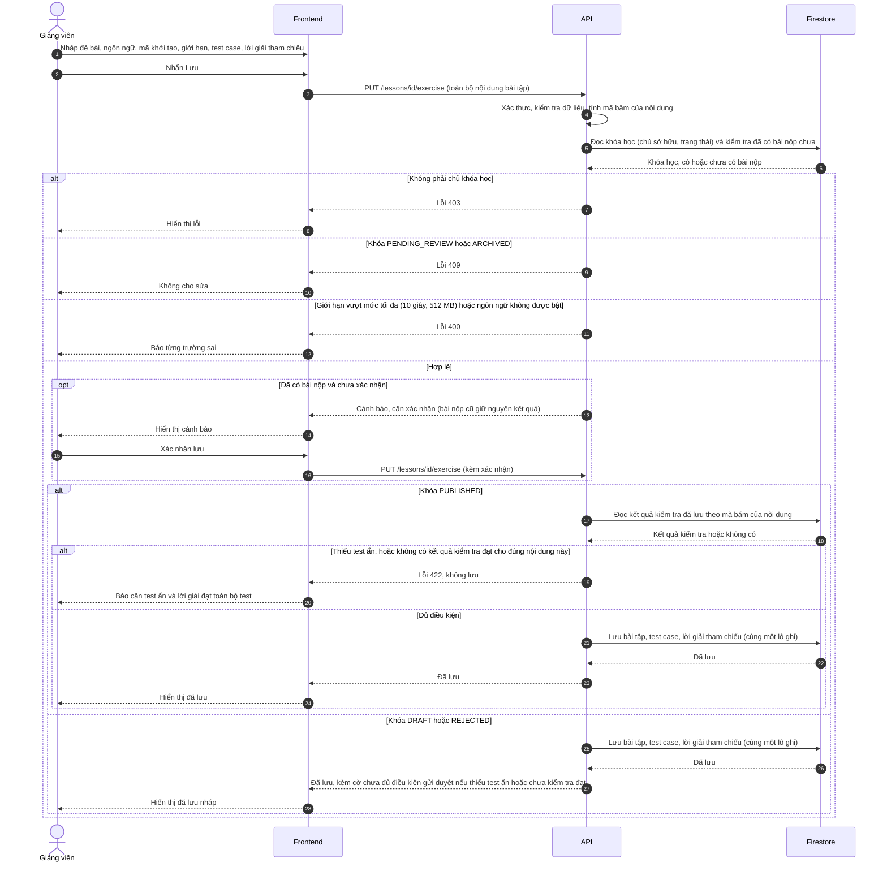

| Bước | Hành động | Ràng buộc liên quan |
|---|---|---|
| 1–6 | Gửi toàn bộ nội dung bài tập, kiểm tra dữ liệu, đọc khóa học và bài nộp | UC-15 (1–3, 6), FR-12, FR-13, NFR-03 |
| 7–8 | Khóa của giảng viên khác thì 403 | UC-15 (\*a), BR-02, AC-05 |
| 9–10 | Khóa `PENDING_REVIEW` hoặc `ARCHIVED` không cho sửa | UC-15 (\*b), §3.2 |
| 11–12 | Giới hạn vượt mức tối đa hoặc ngôn ngữ không được bật thì 400 | UC-15 (2a), FR-12 |
| 13–16 | Đã có bài nộp thì cảnh báo, bài nộp cũ giữ nguyên kết quả | UC-15 (6a), §3.2 |
| 17–20 | Khóa `PUBLISHED`: từ chối nếu thiếu test ẩn hoặc lời giải không đạt cho đúng nội dung này | UC-15 (6b), §3.2, AC-43 |
| 21–24 | Lưu bài tập, test case và lời giải tham chiếu | UC-15 (hậu điều kiện), FR-12, FR-13, FR-14 |
| 25–28 | Khóa `DRAFT` hoặc `REJECTED`: lưu nháp, đánh dấu chưa đủ điều kiện gửi duyệt | UC-15 (5a), AC-06 |

### 10.2 Kiểm tra lời giải tham chiếu

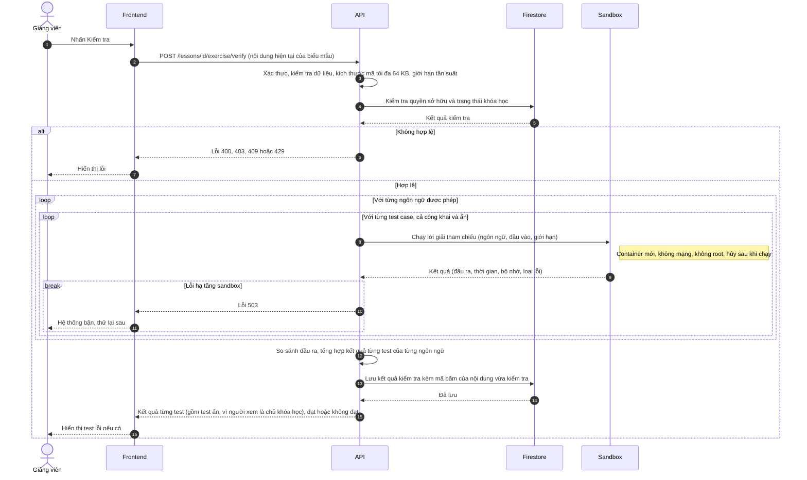

| Bước | Hành động | Ràng buộc liên quan |
|---|---|---|
| 1–5 | Gửi nội dung biểu mẫu, kiểm tra dữ liệu, quyền, kích thước mã và tần suất | UC-15 (4), FR-14, BR-02, BR-13, NFR-03, NFR-06 |
| 6–7 | Từ chối khi không hợp lệ | UC-15 (\*a, \*b), BR-13 |
| 8–9 | Mỗi lượt chạy trong sandbox riêng | UC-27, BR-10, NFR-07, §3.6 |
| 10–11 | Lỗi hạ tầng sandbox thì dừng và báo hệ thống bận | UC-27 (4b) |
| 12–16 | Tổng hợp kết quả từng test, lưu kèm mã băm nội dung; giảng viên thấy cả test ẩn | UC-15 (5, 5a), FR-14, BR-05 |

### 10.3 Điểm thiết kế cần xác nhận

1. **Kiểm tra gắn với mã băm nội dung.** Để thực thi AC-43 mà không chạy lại sandbox mỗi lần lưu khóa `PUBLISHED`, kết quả kiểm tra được lưu kèm mã băm của đề, test case và lời giải. Sửa bất cứ phần nào thì mã băm đổi và phải kiểm tra lại. Cách này cũng trả lời câu hỏi mở số 8 (UC-28 dùng kết quả đã lưu hay chạy lại); nếu chọn chạy lại thì khối kiểm tra ở 6.1 vẫn dùng được.
2. **Kiểm tra đồng bộ có thể quá thời gian chờ.** Số lượt chạy bằng số ngôn ngữ nhân số test. Với bài nhiều test và nhiều ngôn ngữ, một yêu cầu HTTP có thể không đủ; cần đưa qua hàng đợi như UC-09 hoặc chạy song song có giới hạn. Gắn với quyết định Judge0 hay runner tự xây (câu hỏi mở số 1).
3. **Lưu test ẩn và lời giải tham chiếu ở collection riêng** để đường đọc của người học không bao giờ chạm tới (BR-09), như điểm 5 ở 9.3. Giảng viên và admin đọc được (BR-05).
4. **Giới hạn ghi của Firestore.** Một yêu cầu ghi tối đa 10 MiB và mỗi document tối đa 1 MiB, nên bài có test case lớn (đầu vào, đầu ra dài) cần chia thành nhiều document và nhiều lô. Khi đó việc lưu không còn nguyên tử; có thể ghi test mới với mã phiên bản rồi mới đổi con trỏ phiên bản của bài tập trong một thao tác duy nhất.
5. **Bài nộp cũ và chấm lại.** UC-15 (6a) nói bài nộp cũ giữ nguyên kết quả. Requirements chưa nói khi chấm lại bài `INTERNAL_ERROR` (UC-19) thì dùng test case hiện tại hay phiên bản lúc nộp. Nên lưu phiên bản bài tập trong bài nộp.
6. **Còn ít nhất một test ẩn khi xóa test.** Kiểm tra này phải nằm trong cùng thao tác với việc xóa, nếu không hai yêu cầu đồng thời có thể cùng xóa hai test ẩn cuối cùng.

---

## 11. UC-16 — Tạo mục QUIZ và soạn câu hỏi

Câu hỏi hợp lệ theo FR-15: có ít nhất 2 lựa chọn, ít nhất một đáp án đúng, câu một đáp án chỉ có một đáp án đúng (AC-38). Khóa `PUBLISHED` được sửa ngay nhưng không được để mục QUIZ mất hết câu hỏi hợp lệ (AC-43).

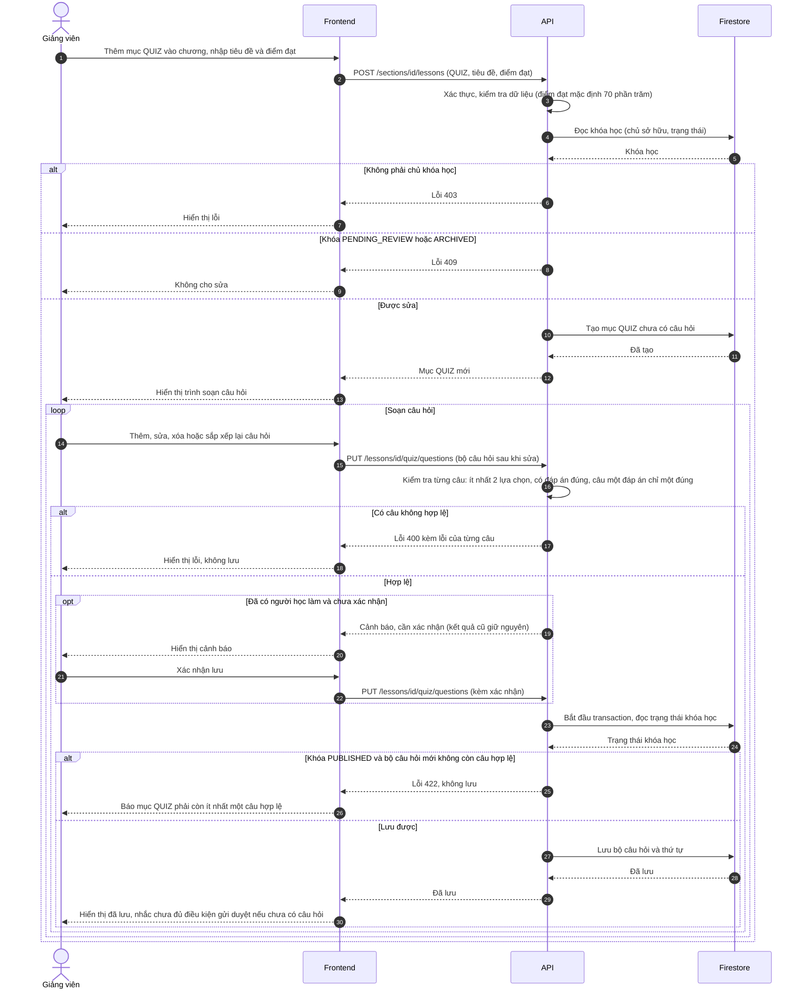

| Bước | Hành động | Ràng buộc liên quan |
|---|---|---|
| 1–5 | Tạo mục QUIZ với tiêu đề và điểm đạt, mặc định 70 phần trăm | UC-16 (1, 2), FR-15 |
| 6–7 | Khóa của giảng viên khác thì 403 | UC-16 (\*a), BR-02 |
| 8–9 | Khóa `PENDING_REVIEW` hoặc `ARCHIVED` không cho sửa | UC-16 (\*b), §3.2 |
| 10–13 | Tạo mục QUIZ chưa có câu hỏi, mở trình soạn | UC-16 (5a), FR-11 |
| 14–18 | Câu dưới 2 lựa chọn, không có đáp án đúng hoặc câu một đáp án có nhiều đáp án đúng thì không lưu | UC-16 (3a–3c), FR-15, NFR-03, AC-38 |
| 19–22 | Đã có người học làm thì cảnh báo, kết quả cũ giữ nguyên | UC-16 (5c) |
| 23–26 | Khóa `PUBLISHED` không cho lưu nếu mục không còn câu hỏi hợp lệ | UC-16 (5b), §3.2, AC-43 |
| 27–30 | Lưu bộ câu hỏi; khóa `DRAFT` hoặc `REJECTED` lưu được dù chưa có câu hỏi nhưng chưa đủ điều kiện gửi duyệt | UC-16 (4, 5, 5a), AC-06 |

### 11.1 Điểm thiết kế cần xác nhận

1. **Cảnh báo trước khi sửa khi đã có người làm.** Sơ đồ yêu cầu xác nhận qua một lần gọi thứ hai kèm cờ xác nhận. Cách khác là API trả cờ cảnh báo ngay khi giảng viên mở trình soạn, để không tốn một lượt gọi bị từ chối.
2. **Sửa câu hỏi không làm đổi kết quả cũ** (UC-16 5c, UC-29). Mỗi lần làm nên lưu kèm nội dung câu hỏi và đáp án đã chọn, hoặc câu hỏi có phiên bản, như điểm 2 ở 7.1.
3. **Thứ tự câu hỏi.** Sắp xếp lại bằng mảng ID trong document mục QUIZ (một lần ghi) hoặc trường thứ tự trong từng câu (nhiều lần ghi). Mảng ID đơn giản hơn với bộ câu hỏi nhỏ.
4. **Gửi cả bộ câu hỏi mỗi lần lưu.** Sơ đồ gửi toàn bộ bộ câu hỏi để kiểm tra bất biến của khóa `PUBLISHED` nguyên tử. Bộ rất lớn nên chuyển sang gửi phần thay đổi và kiểm tra lại số câu hợp lệ trong transaction.

---

## 12. UC-30 — Tạo và cấu hình bài đánh giá

Bài đánh giá lưu **bản sao** câu hỏi và bài tập đã chọn (BR-20), nên sửa hoặc xóa mục học gốc về sau không ảnh hưởng bài đã tạo. Bài đã có lần làm bị khóa nội dung và cấu hình, chỉ cho gia hạn ngày đóng.

### 12.1 Tạo bài đánh giá

```mermaid
sequenceDiagram
  autonumber
  actor GV as Giảng viên
  participant FE as Frontend
  participant API as API
  participant DB as Firestore

  GV->>FE: Chọn Tạo bài đánh giá trong khóa học
  FE->>API: GET /courses/id/assessment-sources
  API->>API: Xác thực, kiểm tra tài khoản còn hoạt động
  API->>DB: Đọc khóa học và các mục QUIZ, CODING kèm kết quả kiểm tra của bài CODING
  DB-->>API: Khóa học, câu hỏi, bài tập

  alt Không phải chủ khóa học
    API-->>FE: Lỗi 403
    FE-->>GV: Hiển thị lỗi
  else Khóa PENDING_REVIEW hoặc ARCHIVED
    API-->>FE: Lỗi 409
    FE-->>GV: Không cho sửa
  else Được sửa
    API-->>FE: Danh sách có thể chọn, đánh dấu bài CODING chưa đủ điều kiện và QUIZ đang hiện đáp án
    FE-->>GV: Hiển thị, bài CODING chưa đủ điều kiện không chọn được, QUIZ hiện đáp án có cảnh báo
    GV->>FE: Nhập cấu hình, chọn câu hỏi và bài tập, đặt điểm từng phần
    FE->>API: POST /courses/id/assessments (cấu hình, danh sách mục, điểm)
    API->>API: Kiểm tra: ít nhất một mục, tổng điểm lớn hơn 0, điểm đạt không vượt thang điểm, ngày đóng sau ngày mở, thời lượng lớn hơn 0

    alt Dữ liệu không hợp lệ
      API-->>FE: Lỗi 400 kèm từng trường
      FE-->>GV: Hiển thị lỗi
    else Hợp lệ
      API->>DB: Đọc lại các mục đã chọn, kiểm tra bài CODING còn test ẩn và lời giải đạt
      DB-->>API: Các mục đã chọn

      alt Có mục không đủ điều kiện
        API-->>FE: Lỗi 422 kèm các mục không đủ điều kiện
        FE-->>GV: Hiển thị lỗi
      else Đủ điều kiện
        API->>DB: Tạo bài đánh giá và bản sao các mục đã chọn
        Note over API,DB: Bản sao gồm câu hỏi, đáp án đúng, bài tập, test case và giới hạn, độc lập với mục gốc
        DB-->>API: Đã tạo
        API-->>FE: Bài đánh giá mới
        FE-->>GV: Hiển thị bài đánh giá
      end
    end
  end
```

| Bước | Hành động | Ràng buộc liên quan |
|---|---|---|
| 1–5 | Lấy các mục QUIZ, CODING có thể nhập vào bài đánh giá | UC-30 (1, 3), BR-02 |
| 6–9 | Khóa của giảng viên khác thì 403; khóa `PENDING_REVIEW` hoặc `ARCHIVED` không cho sửa | UC-30 (\*a, \*b) |
| 10–11 | Bài CODING chưa đủ điều kiện không chọn được; QUIZ đang hiện đáp án có cảnh báo | UC-30 (3a, 3b) |
| 12–16 | Kiểm tra cấu hình: ít nhất một mục, tổng điểm lớn hơn 0, điểm đạt không vượt thang điểm, ngày đóng sau ngày mở, thời lượng lớn hơn 0 | UC-30 (2, 4, 5, 5a), FR-16, AC-39 |
| 17–20 | Kiểm tra lại điều kiện bài CODING ở máy chủ | UC-30 (3a), AC-39 |
| 21–24 | Tạo bài đánh giá cùng bản sao, độc lập với mục gốc | UC-30 (3, 6b), FR-16, BR-20 |

### 12.2 Sửa cấu hình và gia hạn ngày đóng

```mermaid
sequenceDiagram
  autonumber
  actor GV as Giảng viên
  participant FE as Frontend
  participant API as API
  participant DB as Firestore

  GV->>FE: Sửa cấu hình hoặc gia hạn ngày đóng
  FE->>API: PUT /assessments/id
  API->>API: Xác thực, kiểm tra dữ liệu
  API->>DB: Bắt đầu transaction, đọc bài đánh giá (cờ đã có lần làm, ngày đóng) và khóa học
  DB-->>API: Bài đánh giá và khóa học

  alt Không phải chủ khóa học
    API-->>FE: Lỗi 403
    FE-->>GV: Hiển thị lỗi
  else Khóa PENDING_REVIEW hoặc ARCHIVED
    API-->>FE: Lỗi 409
    FE-->>GV: Không cho sửa
  else Đã có lần làm
    alt Chỉ dời ngày đóng ra sau ngày đóng hiện tại
      API->>DB: Cập nhật ngày đóng
      DB-->>API: Đã cập nhật
      API-->>FE: Đã gia hạn
      FE-->>GV: Hiển thị ngày đóng mới
    else Có thay đổi khác hoặc rút ngắn ngày đóng
      API-->>FE: Lỗi 409, nội dung và cấu hình đã bị khóa
      FE-->>GV: Chỉ cho gia hạn ngày đóng
    end
  else Chưa có lần làm
    API->>DB: Cập nhật cấu hình và các mục
    DB-->>API: Đã cập nhật
    API-->>FE: Đã lưu
    FE-->>GV: Hiển thị đã lưu
  end
  Note over API,DB: Khi bắt đầu lần làm đầu tiên (xem 3.1), API cũng đọc bài đánh giá trong transaction và đặt cờ đã có lần làm, nên việc sửa và việc bắt đầu không thể cùng thành công
```

| Bước | Hành động | Ràng buộc liên quan |
|---|---|---|
| 1–5 | Đọc bài đánh giá và cờ đã có lần làm trong transaction | UC-30 (6a), BR-20 |
| 6–9 | Khóa của giảng viên khác thì 403; khóa `PENDING_REVIEW` hoặc `ARCHIVED` không cho sửa | UC-30 (\*a, \*b), BR-02 |
| 10–13 | Đã có lần làm: chỉ cho gia hạn ngày đóng | UC-30 (6a), BR-20, AC-39 |
| 14–15 | Thay đổi khác hoặc rút ngắn ngày đóng thì từ chối | BR-20, AC-39 |
| 16–19 | Chưa có lần làm thì sửa tự do | UC-30 (2), FR-16 |

### 12.3 Điểm thiết kế cần xác nhận

1. **Cờ đã có lần làm cần đồng bộ với UC-11.** Để BR-20 đúng khi sửa và bắt đầu làm bài xảy ra cùng lúc, sơ đồ 3.1 phải đặt cờ này trong transaction bắt đầu lần làm đầu tiên. Cờ chỉ ghi khi chuyển từ chưa có sang đã có, các lần bắt đầu sau chỉ đọc, để không dồn ghi vào một document (Firestore chịu ghi liên tục vào một document kém hơn nhiều document khác nhau).
2. **Bản sao lớn.** Bài có nhiều bài CODING mỗi bài nhiều test case dễ vượt 10 MiB mỗi yêu cầu ghi, và mỗi document tối đa 1 MiB. Nên lưu bản sao thành các document con của bài đánh giá và tạo bằng nhiều lô, đánh dấu bài đánh giá là hoàn tất sau lô cuối để không có bài thiếu mục.
3. **Kiểm tra điều kiện của bài CODING hai lần.** Một lần lúc lấy danh sách (chỉ để giao diện biết mục nào chọn được) và một lần lúc tạo, vì khóa `PUBLISHED` có thể đổi giữa hai bước.
4. **Cảnh báo câu QUIZ đang hiện đáp án** (UC-30 3b) chỉ mang tính gợi ý, không chặn. Cần xác nhận có muốn chặn hẳn không.
5. **Kết quả code của bài đánh giá tách khỏi bài nộp** (BR-19). Bản sao bài tập trong bài đánh giá cũng dùng để chấm phần code, nên worker cần đọc test case từ bản sao, không từ mục gốc.

---

## 13. UC-22, UC-21 — Quản lý người dùng và lưu trữ khóa học

Hai thao tác của admin có ảnh hưởng lan rộng nên đều dùng điều kiện trạng thái trong transaction.

### 13.1 Vô hiệu hóa hoặc kích hoạt lại tài khoản

```mermaid
sequenceDiagram
  autonumber
  actor AD as Admin
  participant FE as Frontend
  participant API as API
  participant DB as Firestore

  AD->>FE: Mở quản lý người dùng, tìm và lọc theo vai trò, trạng thái
  FE->>API: GET /admin/users (từ khóa, vai trò, trạng thái, trang)
  API->>API: Xác thực, kiểm tra vai trò Admin
  API->>DB: Truy vấn người dùng
  DB-->>API: Danh sách người dùng
  API-->>FE: Danh sách có phân trang
  FE-->>AD: Hiển thị danh sách

  AD->>FE: Chọn một tài khoản, nhấn Vô hiệu hóa
  FE->>API: PATCH /admin/users/id (isActive là false)
  API->>API: Xác thực, kiểm tra vai trò Admin
  API->>DB: Bắt đầu transaction, đọc tài khoản đích và danh sách admin đang hoạt động
  DB-->>API: Tài khoản đích, các admin đang hoạt động

  alt Không phải Admin
    API-->>FE: Lỗi 403
    FE-->>AD: Hiển thị lỗi
  else Tự vô hiệu hóa mình hoặc admin hoạt động cuối cùng
    API-->>FE: Lỗi 409
    FE-->>AD: Báo không thể vô hiệu hóa
  else Hợp lệ
    API->>DB: Đặt isActive là false và thu hồi các refresh token của tài khoản
    DB-->>API: Đã cập nhật
    API-->>FE: Đã vô hiệu hóa
    FE-->>AD: Cập nhật trạng thái trong danh sách
  end
  Note over API,DB: Từ yêu cầu kế tiếp, token cũ của tài khoản bị từ chối vì mỗi yêu cầu kiểm tra isActive (xem 4.3). Kích hoạt lại dùng cùng luồng, đặt isActive là true và không cần kiểm tra admin cuối cùng
```

| Bước | Hành động | Ràng buộc liên quan |
|---|---|---|
| 1–7 | Admin tìm và lọc người dùng theo vai trò, trạng thái | UC-22 (1), FR-06 |
| 8–12 | Chọn tài khoản, đọc tài khoản đích và các admin đang hoạt động trong transaction | UC-22 (2), FR-04 |
| 13–14 | Không phải admin thì 403 | NFR-02 |
| 15–16 | Tự vô hiệu hóa mình hoặc admin hoạt động cuối cùng thì từ chối | UC-22 (2a), FR-06, AC-32 |
| 17–20 | Đặt `isActive` là false, thu hồi refresh token; token cũ bị từ chối từ yêu cầu kế tiếp | UC-22 (3), FR-04, NFR-05, AC-30 |

### 13.2 Gỡ khóa học xuống (lưu trữ)

```mermaid
sequenceDiagram
  autonumber
  actor AD as Admin
  actor L as Người học đã ghi danh
  actor L2 as Người học chưa ghi danh
  participant FE as Frontend
  participant API as API
  participant DB as Firestore

  AD->>FE: Chọn khóa học PUBLISHED, nhấn Gỡ xuống
  FE->>API: POST /admin/courses/id/archive
  API->>API: Xác thực, kiểm tra vai trò Admin
  API->>DB: Chuyển ARCHIVED, chỉ khi đang PUBLISHED
  DB-->>API: Kết quả cập nhật có điều kiện

  alt Không cập nhật được vì khóa không còn PUBLISHED
    API-->>FE: Lỗi 409
    FE-->>AD: Báo trạng thái đã thay đổi, tải lại
  else Chuyển được
    API-->>FE: Đã lưu trữ
    FE-->>AD: Cập nhật trạng thái khóa học
  end

  Note over L,DB: Sau khi lưu trữ
  L->>FE: Mở khóa học đã ghi danh
  FE->>API: GET /courses/id/outline
  API->>DB: Đọc khóa học và ghi danh
  DB-->>API: Khóa ARCHIVED, ghi danh còn hiệu lực
  API-->>FE: Đề cương và nội dung như trước
  FE-->>L: Vẫn học được

  L2->>FE: Nhấn Ghi danh
  FE->>API: POST /courses/id/enrollments
  API-->>FE: Lỗi 409, khóa không còn nhận ghi danh
  FE-->>L2: Báo khóa học đã ngừng nhận ghi danh
```

| Bước | Hành động | Ràng buộc liên quan |
|---|---|---|
| 1–9 | Admin chuyển `PUBLISHED` sang `ARCHIVED`, chỉ khi đang `PUBLISHED` | UC-21, FR-19, §3.2 |
| 10–15 | Người đã ghi danh vẫn truy cập sau khi lưu trữ | BR-06, AC-14 |
| 16–19 | Người chưa ghi danh không ghi danh mới được | BR-01, UC-06 (2a) |

### 13.3 Điểm thiết kế cần xác nhận

1. **Admin hoạt động cuối cùng.** Số admin ít nên transaction đọc luôn danh sách admin đang hoạt động, không cần bộ đếm riêng. Thiết kế này thất bại nếu về sau có hàng nghìn admin, khi đó nên dùng bộ đếm.
2. **Tìm kiếm người dùng.** FR-06 yêu cầu tìm kiếm, nhưng Firestore không có tìm kiếm toàn văn. Chỉ hỗ trợ tìm theo khớp chính xác hoặc tiền tố của email và tên (truy vấn khoảng). Tìm theo từ khóa tự do cần dịch vụ ngoài hoặc lọc trên tập nhỏ.
3. **Giảng viên bị vô hiệu hóa có khóa `PUBLISHED`** (UC-22 3a, câu hỏi mở số 6): giữ nguyên, lưu trữ hay chuyển giảng viên. Sơ đồ chưa xử lý các khóa này. Nếu chọn lưu trữ hàng loạt thì nên ghi theo lô (BulkWriter) thay vì một transaction dài.
4. **Access token đã cấp.** Thu hồi refresh token chỉ chặn việc làm mới. Access token còn hạn (khoảng 15 phút) vẫn bị từ chối nhờ kiểm tra `isActive` ở mỗi yêu cầu (NFR-05, AC-30), nên việc kiểm tra này không được bỏ hay đệm lâu (xem điểm 4 ở 4.5).
5. **Khôi phục khóa `ARCHIVED`** chưa được quy định (có trong danh sách câu hỏi mở của backlog). Sơ đồ coi lưu trữ là một chiều.
6. **Danh sách công khai.** Khóa `ARCHIVED` biến mất khỏi danh sách và tìm kiếm công khai (UC-04) nhờ điều kiện lọc theo trạng thái `PUBLISHED`; truy vấn lọc kết hợp sắp xếp cần chỉ mục tổng hợp.
