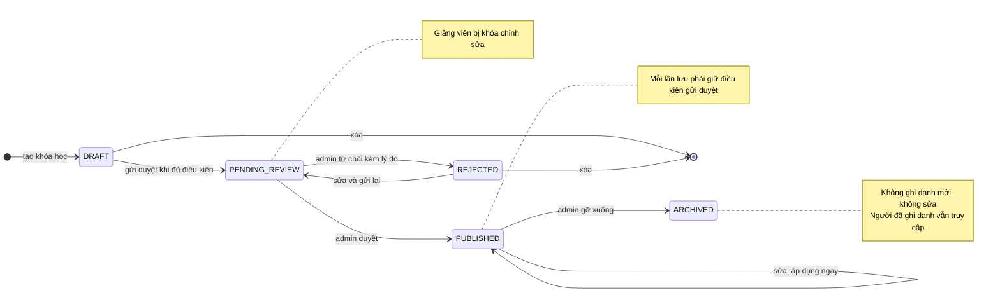
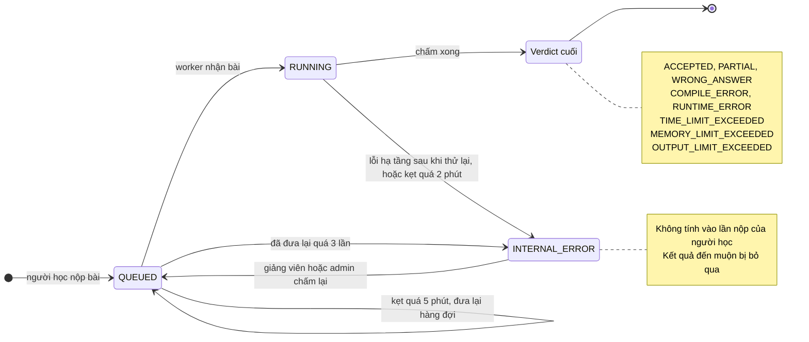
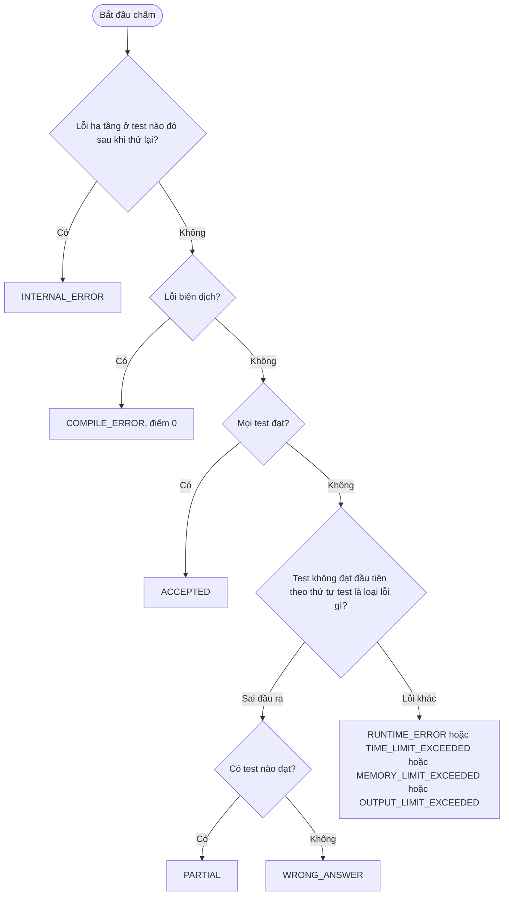
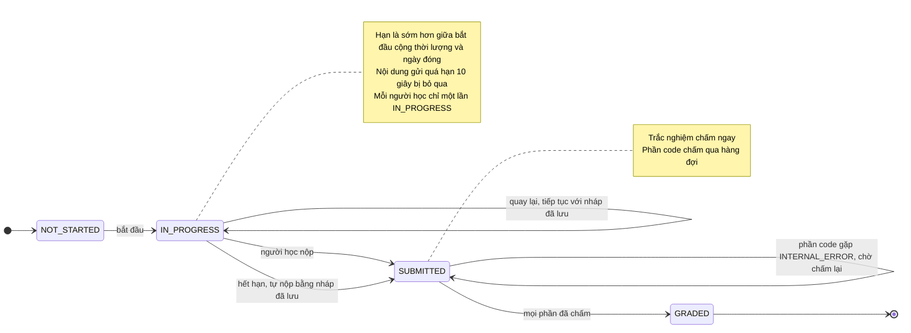

# CodePath — Sơ đồ trạng thái

| | |
|---|---|
| **Phiên bản** | 1.1 |
| **Tài liệu liên quan** | `requirements.md` (v1.1), `use-case.md` (v1.1) |

> Tài liệu này minh họa các vòng đời ở §3.2, §3.3, §3.4 của `requirements.md`. Khi hai nơi khác nhau, `requirements.md` là nguồn chuẩn.

## Mục lục

1. [Vòng đời khóa học](#1-vòng-đời-khóa-học)
2. [Vòng đời bài nộp](#2-vòng-đời-bài-nộp)
3. [Vòng đời lần làm bài đánh giá](#3-vòng-đời-lần-làm-bài-đánh-giá)
4. [Ghi chú và khoảng trống](#4-ghi-chú-và-khoảng-trống)

---

## 1. Vòng đời khóa học

Nguồn: §3.2.

| Chuyển trạng thái | Tác nhân | Điều kiện | Use case |
|---|---|---|---|
| tạo → `DRAFT` | Giảng viên | Đã đăng nhập | UC-13 |
| `DRAFT` → `PENDING_REVIEW` | Giảng viên | UC-28 báo đạt: đủ thông tin, mỗi bài CODING có test ẩn và lời giải đạt, mỗi mục QUIZ có câu hỏi hợp lệ | UC-17, UC-28 |
| `PENDING_REVIEW` → `PUBLISHED` | Admin | Duyệt | UC-20 |
| `PENDING_REVIEW` → `REJECTED` | Admin | Lý do 10–1000 ký tự | UC-20 |
| `REJECTED` → `PENDING_REVIEW` | Giảng viên | Sửa rồi gửi lại, qua lại UC-28 | UC-17, UC-28 |
| `PUBLISHED` → `PUBLISHED` | Giảng viên | Lưu giữ được bất biến: bài CODING còn test ẩn và lời giải đạt, mục QUIZ còn câu hỏi hợp lệ | UC-14, UC-15, UC-16 |
| `PUBLISHED` → `ARCHIVED` | Admin | Gỡ xuống | UC-21 |
| `DRAFT` hoặc `REJECTED` → xóa | Giảng viên | Chưa từng có ghi danh | UC-13 |

Tham chiếu: BR-01, BR-03, BR-06; AC-02, AC-06, AC-07, AC-08, AC-14, AC-43.

## 2. Vòng đời bài nộp

Nguồn: §3.3.

### 2.1 Trạng thái

| Chuyển trạng thái | Tác nhân | Điều kiện | Use case |
|---|---|---|---|
| tạo → `QUEUED` | Người học | Qua kiểm tra quyền, kích thước mã, ngôn ngữ, giới hạn tần suất | UC-09 |
| `QUEUED` → `RUNNING` | Worker | Nhận việc từ hàng đợi | UC-25 |
| `RUNNING` → verdict cuối | Worker | Chấm xong mọi test | UC-25 |
| `RUNNING` → `INTERNAL_ERROR` | Worker hoặc bộ định thời | Lỗi sandbox sau khi thử lại có giới hạn, hoặc `RUNNING` quá 2 phút | UC-25, UC-26 |
| `QUEUED` → `QUEUED` | Bộ định thời | `QUEUED` quá 5 phút, tối đa 3 lần | UC-26 |
| `QUEUED` → `INTERNAL_ERROR` | Bộ định thời | Vượt 3 lần đưa lại | UC-26 |
| `INTERNAL_ERROR` → `QUEUED` | Giảng viên (khóa của mình), Admin | Chấm lại, tạo bản ghi kết quả mới | UC-19 |

Tham chiếu: BR-08, BR-11, BR-12, NFR-11; AC-21, AC-23.

### 2.2 Cách xác định verdict cuối

Nguồn: quy tắc xác định verdict ở §3.3. Điểm luôn bằng tổng trọng số các test đạt, bất kể verdict.

Tham chiếu: AC-15, AC-16, AC-17, AC-44.

## 3. Vòng đời lần làm bài đánh giá

Nguồn: §3.4.

| Chuyển trạng thái | Tác nhân | Điều kiện | Use case |
|---|---|---|---|
| `NOT_STARTED` → `IN_PROGRESS` | Người học | Trong khoảng ngày mở/đóng, còn lượt làm, không có lần `IN_PROGRESS` khác | UC-11 |
| `IN_PROGRESS` → `IN_PROGRESS` | Người học | Mất kết nối rồi quay lại, đồng hồ vẫn tính theo máy chủ | UC-11 |
| `IN_PROGRESS` → `SUBMITTED` (nộp) | Người học | Nộp trước hạn | UC-11 |
| `IN_PROGRESS` → `SUBMITTED` (tự nộp) | Bộ định thời | Quá hạn, nộp bằng nháp đã lưu; trùng với người học nộp thì chỉ ghi nhận một lần | UC-26 |
| `SUBMITTED` → `SUBMITTED` | Giảng viên, Admin | Phần code `INTERNAL_ERROR`, chấm lại rồi mới `GRADED` | UC-19 |
| `SUBMITTED` → `GRADED` | Hệ thống | Mọi phần đã chấm; điểm bài đánh giá là điểm cao nhất các lần làm | UC-11, UC-25 |

Tham chiếu: BR-15, BR-16, BR-19, BR-20; AC-25, AC-26, AC-27, AC-28, AC-40.

## 4. Ghi chú và khoảng trống

**Chuyển trạng thái không hợp lệ** (nên có test từ chối, phục vụ NFR-20):

| Sơ đồ | Chuyển không được phép |
|---|---|
| Khóa học | `PUBLISHED` → `DRAFT`; `PENDING_REVIEW` → `DRAFT`; `ARCHIVED` → bất kỳ trạng thái nào; xóa khóa ở `PENDING_REVIEW`, `PUBLISHED` hay `ARCHIVED` |
| Bài nộp | Verdict cuối → bất kỳ trạng thái nào (chỉ `INTERNAL_ERROR` được chấm lại); chấm lại bài không ở `INTERNAL_ERROR` |
| Bài đánh giá | `GRADED` → `IN_PROGRESS`; bắt đầu lần mới khi đang có lần `IN_PROGRESS` hoặc đã hết lượt |

**Khoảng trống hiện có** (chưa có trong `requirements.md`, cần quyết định nếu muốn hỗ trợ):

- **Rút lại yêu cầu duyệt:** khóa `PENDING_REVIEW` bị khóa chỉnh sửa và chỉ thoát ra qua quyết định của admin. Giảng viên không thể tự rút lại.
- **Khôi phục khóa `ARCHIVED`:** chưa có chuyển trạng thái quay lại `PUBLISHED`.
- **Khóa của giảng viên bị vô hiệu hóa:** chưa quyết định (câu hỏi mở ở requirements §10).
- **Hủy ghi danh khi đang làm bài đánh giá:** chưa quyết định (câu hỏi mở ở requirements §10).