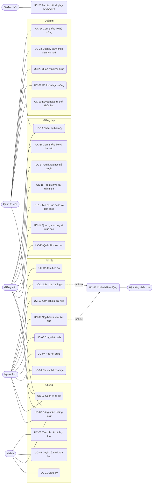

# CodePath — Đặc tả Use case

**Đề tài:** Phát triển nền tảng học lập trình trực tuyến tích hợp môi trường thực hành và đánh giá

| | |
|---|---|
| **Phiên bản** | 1.0 |
| **Tài liệu liên quan** | `codepath-requirements.md` |

> Các mã **FR-xx**, **BR-xx**, **NFR-xx**, **AC-xx** và tham chiếu **§x.x** trong tài liệu này trỏ đến file `codepath-requirements.md`.

## Mục lục

1. [Tác nhân (Actor)](#1-tác-nhân-actor)
2. [Sơ đồ use case](#2-sơ-đồ-use-case)
3. [Danh sách use case](#3-danh-sách-use-case)
4. [Đặc tả chi tiết](#4-đặc-tả-chi-tiết)
5. [Các use case còn lại (tóm tắt)](#5-các-use-case-còn-lại-tóm-tắt)

---

## 1. Tác nhân (Actor)

| Tác nhân | Loại | Mô tả |
|---|---|---|
| Khách (Guest) | Chính | Người chưa đăng nhập. |
| Người học (Learner) | Chính | Kế thừa mọi use case của Khách. |
| Giảng viên (Instructor) | Chính | Tạo nội dung và theo dõi người học; cũng có thể học khóa học của giảng viên khác (§2). |
| Quản trị viên (Admin) | Chính | Kiểm duyệt và vận hành hệ thống. |
| Hệ thống chấm bài (Judge Worker) | Phụ (hệ thống) | Lấy bài nộp từ hàng đợi, chạy trong sandbox và ghi kết quả. |
| Bộ định thời (Scheduler) | Phụ (hệ thống) | Tự nộp bài đánh giá khi hết giờ và phục hồi bài nộp bị kẹt. |

## 2. Sơ đồ use case

## 3. Danh sách use case

| ID | Use case | Tác nhân chính | Yêu cầu liên quan |
|---|---|---|---|
| UC-01 | Đăng ký tài khoản | Khách | FR-01 |
| UC-02 | Đăng nhập / đăng xuất | Mọi người dùng | FR-02, FR-03 |
| UC-03 | Xem và cập nhật hồ sơ, đổi mật khẩu | Người học, Giảng viên | FR-02, FR-05 |
| UC-04 | Duyệt, tìm kiếm, lọc khóa học | Khách, Người học | FR-07, FR-08 |
| UC-05 | Xem chi tiết khóa học và mục học xem thử | Khách, Người học | FR-09, FR-24 |
| UC-06 | Ghi danh và hủy ghi danh khóa học | Người học | FR-23 |
| UC-07 | Học nội dung và đánh dấu hoàn thành | Người học | FR-24, FR-25 |
| UC-08 | Chạy thử code | Người học | FR-26, FR-27, FR-31 |
| UC-09 | Nộp bài và xem kết quả chấm | Người học | FR-28, FR-29, FR-31 |
| UC-10 | Xem lịch sử bài nộp | Người học | FR-30 |
| UC-11 | Làm bài đánh giá | Người học | FR-33, FR-34 |
| UC-12 | Xem tiến độ và bảng tổng hợp cá nhân | Người học | FR-25, FR-37 |
| UC-13 | Tạo, sửa, xóa khóa học | Giảng viên | FR-10, FR-17 |
| UC-14 | Quản lý chương và mục học | Giảng viên | FR-11 |
| UC-15 | Tạo bài tập code và quản lý test case | Giảng viên | FR-12, FR-13, FR-14 |
| UC-16 | Tạo quiz và bài đánh giá | Giảng viên | FR-15, FR-16 |
| UC-17 | Gửi khóa học để duyệt | Giảng viên | FR-17 |
| UC-18 | Xem thống kê khóa học và bài nộp của người học | Giảng viên | FR-35, FR-36 |
| UC-19 | Chấm lại bài nộp | Giảng viên, Admin | FR-32 |
| UC-20 | Duyệt hoặc từ chối khóa học | Admin | FR-18 |
| UC-21 | Gỡ khóa học xuống (lưu trữ) | Admin | FR-19 |
| UC-22 | Quản lý người dùng | Admin | FR-04, FR-06 |
| UC-23 | Quản lý danh mục và ngôn ngữ lập trình | Admin | FR-20, FR-21 |
| UC-24 | Xem thống kê hệ thống | Admin | FR-22 |
| UC-25 | Chấm bài tự động | Hệ thống chấm bài | FR-28, FR-34 |
| UC-26 | Tự nộp bài khi hết giờ và phục hồi bài nộp bị kẹt | Bộ định thời | FR-32, FR-33 |

**Quan hệ giữa các use case**

| Quan hệ | Mô tả |
|---|---|
| UC-09 «include» UC-25 | Mỗi lần nộp bài đều dẫn đến chấm tự động. |
| UC-11 «include» UC-25 | Phần code của bài đánh giá được chấm tự động. |
| UC-17 «include» kiểm tra điều kiện gửi duyệt | Kiểm tra theo §3.2 (có mục học, test case ẩn, lời giải tham chiếu đạt). |
| UC-15 «include» chạy lời giải tham chiếu | Dùng sandbox giống UC-25 để xác nhận lời giải đạt toàn bộ test case. |
| UC-08 «extend» UC-09 | Người học có thể chạy thử trước khi nộp (không bắt buộc). |
| UC-05 «extend» UC-06 | Từ trang chi tiết, người dùng có thể chọn ghi danh. |

## 4. Đặc tả chi tiết

### UC-01 — Đăng ký tài khoản

| Mục | Nội dung |
|---|---|
| **Tác nhân** | Khách |
| **Mô tả** | Khách tạo tài khoản mới để học hoặc giảng dạy. |
| **Tiền điều kiện** | Khách chưa đăng nhập. |
| **Hậu điều kiện** | Tài khoản mới ở trạng thái hoạt động; người dùng đã đăng nhập. |
| **Luồng chính** | 1. Khách mở trang đăng ký. 2. Nhập email, mật khẩu, tên hiển thị và chọn vai trò (`LEARNER` hoặc `INSTRUCTOR`). 3. Hệ thống kiểm tra dữ liệu (Zod) và tính duy nhất của email. 4. Hệ thống băm mật khẩu, tạo tài khoản. 5. Hệ thống đăng nhập và chuyển đến trang chủ. |
| **Luồng thay thế / ngoại lệ** | 3a. Email đã tồn tại → báo lỗi, giữ lại dữ liệu đã nhập. 3b. Mật khẩu dưới 8 ký tự hoặc dữ liệu sai định dạng → báo lỗi từng trường. 3c. Vai trò là `ADMIN` hoặc giá trị lạ → từ chối (400). *. Vượt giới hạn tần suất → lỗi 429. |
| **Quy tắc liên quan** | NFR-01, NFR-03, NFR-06; AC-31 |

### UC-02 — Đăng nhập / đăng xuất

| Mục | Nội dung |
|---|---|
| **Tác nhân** | Mọi người dùng |
| **Tiền điều kiện** | Đã có tài khoản. |
| **Hậu điều kiện** | Đăng nhập: có access token và refresh token. Đăng xuất: refresh token bị thu hồi. |
| **Luồng chính** | 1. Người dùng nhập email và mật khẩu. 2. Hệ thống xác thực và kiểm tra tài khoản còn hoạt động. 3. Hệ thống cấp access token (≈15 phút) và refresh token (cookie `httpOnly`). 4. Người dùng được chuyển đến trang phù hợp với vai trò. 5. Khi đăng xuất, hệ thống thu hồi refresh token và xóa phiên phía client. |
| **Luồng thay thế / ngoại lệ** | 2a. Sai email hoặc mật khẩu → thông báo chung "thông tin không đúng" (không tiết lộ email có tồn tại). 2b. Tài khoản bị vô hiệu hóa → từ chối đăng nhập. 2c. Quá nhiều lần thử → 429. *. Access token hết hạn → client dùng refresh token để lấy token mới; refresh token không hợp lệ → yêu cầu đăng nhập lại. |
| **Quy tắc liên quan** | NFR-05, NFR-06; AC-30 |

### UC-06 — Ghi danh khóa học

| Mục | Nội dung |
|---|---|
| **Tác nhân** | Người học (hoặc Giảng viên với khóa của người khác) |
| **Tiền điều kiện** | Đã đăng nhập; khóa học ở trạng thái `PUBLISHED`. |
| **Hậu điều kiện** | Tồn tại đúng một bản ghi ghi danh `(người dùng, khóa học)`; tiến độ bắt đầu ở 0%. |
| **Luồng chính** | 1. Người dùng nhấn "Ghi danh" ở trang chi tiết khóa học. 2. Hệ thống kiểm tra khóa học đang `PUBLISHED` và người dùng không phải chủ khóa học. 3. Hệ thống tạo ghi danh. 4. Hệ thống chuyển người dùng đến trang học của khóa học. |
| **Luồng thay thế / ngoại lệ** | 2a. Khóa học không còn `PUBLISHED` → báo lỗi, không ghi danh. 2b. Người dùng là chủ khóa học → từ chối (403). 3a. Đã ghi danh (kể cả yêu cầu đồng thời) → ràng buộc unique chặn bản ghi trùng; trả về ghi danh hiện có. *. Hủy ghi danh: người học chọn "Hủy ghi danh"; hệ thống xác nhận rồi xóa ghi danh (tiến độ và bài nộp vẫn được lưu). |
| **Quy tắc liên quan** | BR-01, BR-04, BR-06; AC-09, AC-10 |

### UC-08 — Chạy thử code

| Mục | Nội dung |
|---|---|
| **Tác nhân** | Người học; hệ thống chấm bài (phụ) |
| **Tiền điều kiện** | Đã ghi danh khóa học chứa bài tập (hoặc bài tập nằm trong mục xem thử). |
| **Hậu điều kiện** | Hiển thị kết quả chạy; **không** tạo bài nộp, không ảnh hưởng điểm hay tiến độ. |
| **Luồng chính** | 1. Người học mở bài tập, chọn ngôn ngữ và viết code trong trình soạn (nháp tự động lưu). 2. Người học nhấn "Chạy thử", chọn test mẫu hoặc nhập đầu vào tùy chọn. 3. Hệ thống kiểm tra quyền, độ dài mã và giới hạn tần suất. 4. Hệ thống đưa yêu cầu cho sandbox chạy với giới hạn thời gian/bộ nhớ. 5. Hệ thống trả về stdout, stderr, thời gian và bộ nhớ sử dụng. |
| **Luồng thay thế / ngoại lệ** | 3a. Mã vượt 64 KB hoặc ngôn ngữ không được bật → từ chối (BR-13). 3b. Vượt giới hạn tần suất → 429. 4a. Mã lỗi biên dịch → hiển thị thông báo lỗi. 4b. Quá thời gian, quá bộ nhớ hoặc quá đầu ra → hiển thị loại lỗi tương ứng. 4c. Runner không khả dụng → thông báo "hệ thống bận, thử lại sau". |
| **Quy tắc liên quan** | BR-05, BR-10, BR-13, BR-14; AC-12, AC-17, AC-18 |

### UC-09 — Nộp bài và xem kết quả chấm

| Mục | Nội dung |
|---|---|
| **Tác nhân** | Người học; hệ thống chấm bài (phụ) |
| **Tiền điều kiện** | Đã ghi danh; bài tập thuộc khóa học `PUBLISHED` hoặc `ARCHIVED` mà người học đã ghi danh. |
| **Hậu điều kiện** | Có bản ghi bài nộp với verdict và điểm; tiến độ cập nhật nếu `ACCEPTED`. |
| **Luồng chính** | 1. Người học nhấn "Nộp bài". 2. Hệ thống kiểm tra quyền, ngôn ngữ, kích thước mã và giới hạn tần suất. 3. Hệ thống tạo bài nộp `QUEUED`, đưa vào hàng đợi và phản hồi ngay. 4. Giao diện hiển thị trạng thái đang chờ, cập nhật qua polling hoặc SSE. 5. Hệ thống chấm bài (UC-25) chạy lần lượt các test case và ghi kết quả. 6. Giao diện hiển thị verdict, điểm, và kết quả từng test: test công khai kèm đầu vào/ra, test ẩn chỉ hiển thị đạt hoặc không đạt. 7. Nếu `ACCEPTED`, mục học được đánh dấu hoàn thành. |
| **Luồng thay thế / ngoại lệ** | 2a. Quá giới hạn tần suất → 429. 2b. Mã không hợp lệ (quá dài, ngôn ngữ bị tắt) → từ chối. 5a. `COMPILE_ERROR`, `RUNTIME_ERROR`, `TIME_LIMIT_EXCEEDED`, `MEMORY_LIMIT_EXCEEDED`, `OUTPUT_LIMIT_EXCEEDED` → hiển thị lỗi tương ứng, điểm theo các test đã đạt. 5b. Lỗi hệ thống chấm → `INTERNAL_ERROR`, không tính vào lượt nộp, có thể chấm lại (UC-19, UC-26). *. Client gửi kèm điểm hoặc verdict → bỏ qua. |
| **Quy tắc liên quan** | BR-08, BR-09, BR-11, BR-12, BR-14; AC-15 – AC-24 |

### UC-11 — Làm bài đánh giá

| Mục | Nội dung |
|---|---|
| **Tác nhân** | Người học; hệ thống chấm bài, bộ định thời (phụ) |
| **Tiền điều kiện** | Đã ghi danh; bài đánh giá đang mở; còn lượt làm; không có lần làm `IN_PROGRESS`. |
| **Hậu điều kiện** | Lần làm ở trạng thái `GRADED` với điểm cuối cùng. |
| **Luồng chính** | 1. Người học nhấn "Bắt đầu"; hệ thống ghi thời điểm bắt đầu và tính hạn nộp theo đồng hồ máy chủ. 2. Hệ thống hiển thị câu hỏi (thứ tự được xáo trộn nếu cấu hình) và đồng hồ đếm ngược. 3. Người học trả lời, viết code; hệ thống tự lưu nháp định kỳ. 4. Người học nhấn "Nộp bài" (hoặc hết giờ, hệ thống tự nộp bằng nội dung đã lưu). 5. Hệ thống chấm trắc nghiệm ngay, gửi phần code vào hàng đợi chấm (UC-25). 6. Khi mọi phần đã chấm, lần làm chuyển `GRADED`; người học xem điểm và kết quả theo quy tắc §3.4. |
| **Luồng thay thế / ngoại lệ** | 1a. Hết lượt làm hoặc đang có lần làm khác → từ chối. 1b. Ngoài khoảng ngày mở/đóng → từ chối. 3a. Mất kết nối → đồng hồ vẫn chạy trên máy chủ; khi vào lại, tiếp tục với nháp đã lưu. 4a. Nội dung gửi sau hạn (quá 10 giây du di) → bị bỏ qua. *. Rời tab → ghi log sự kiện (không tự động xử phạt). |
| **Quy tắc liên quan** | BR-15, BR-16, BR-17; AC-25 – AC-28 |

### UC-15 — Tạo bài tập code và quản lý test case

| Mục | Nội dung |
|---|---|
| **Tác nhân** | Giảng viên; hệ thống chấm bài (phụ) |
| **Tiền điều kiện** | Giảng viên đăng nhập, sở hữu khóa học và khóa học ở trạng thái cho phép sửa (§3.2). |
| **Hậu điều kiện** | Bài tập được lưu, kèm test case và lời giải tham chiếu đã được kiểm chứng. |
| **Luồng chính** | 1. Giảng viên thêm mục học loại CODING vào một chương. 2. Nhập đề bài (Markdown), chọn ngôn ngữ cho phép, mã khởi tạo, giới hạn thời gian/bộ nhớ, gợi ý. 3. Thêm test case: đầu vào, đầu ra mong đợi, trọng số, công khai hoặc ẩn. 4. Nhập lời giải tham chiếu và nhấn "Kiểm tra". 5. Hệ thống chạy lời giải qua toàn bộ test case trong sandbox và hiển thị kết quả. 6. Giảng viên lưu bài tập. |
| **Luồng thay thế / ngoại lệ** | 2a. Giới hạn vượt mức tối đa của hệ thống (10 giây, 512 MB) → từ chối. 5a. Lời giải không đạt toàn bộ test → hiển thị test lỗi; bài tập vẫn lưu được ở dạng nháp nhưng **không đủ điều kiện gửi duyệt**. *. Sửa test case khi đã có bài nộp → bài nộp cũ giữ nguyên kết quả (§3.2); hệ thống cảnh báo trước khi lưu. *. Khóa học thuộc giảng viên khác → 403. |
| **Quy tắc liên quan** | BR-02, BR-09, BR-10; AC-04, AC-05, AC-06 |

### UC-17 — Gửi khóa học để duyệt

| Mục | Nội dung |
|---|---|
| **Tác nhân** | Giảng viên |
| **Tiền điều kiện** | Giảng viên sở hữu khóa học; khóa học ở `DRAFT` hoặc `REJECTED`. |
| **Hậu điều kiện** | Khóa học ở `PENDING_REVIEW` và bị khóa chỉnh sửa. |
| **Luồng chính** | 1. Giảng viên nhấn "Gửi duyệt". 2. Hệ thống kiểm tra điều kiện: đủ tiêu đề, mô tả, danh mục; có ít nhất một chương và một mục học; mỗi bài CODING có test case ẩn và lời giải tham chiếu đạt toàn bộ test. 3. Hệ thống chuyển trạng thái sang `PENDING_REVIEW`. |
| **Luồng thay thế / ngoại lệ** | 2a. Thiếu điều kiện → liệt kê cụ thể từng mục còn thiếu, giữ nguyên trạng thái. 1a. Khóa học đang `PENDING_REVIEW`, `PUBLISHED` hoặc `ARCHIVED` → không cho gửi. |
| **Quy tắc liên quan** | BR-02, §3.2; AC-04, AC-06 |

### UC-19 — Chấm lại bài nộp

| Mục | Nội dung |
|---|---|
| **Tác nhân** | Giảng viên (bài nộp trong khóa học của mình), Admin |
| **Tiền điều kiện** | Bài nộp tồn tại; thường ở trạng thái `INTERNAL_ERROR` hoặc cần kiểm tra lại. |
| **Hậu điều kiện** | Có bản ghi kết quả mới, ghi nhận người thực hiện; điểm và tiến độ được cập nhật theo BR-12. |
| **Luồng chính** | 1. Người thực hiện mở bài nộp và nhấn "Chấm lại". 2. Hệ thống kiểm tra quyền (giảng viên chỉ với khóa học của mình). 3. Hệ thống đưa bài nộp vào hàng đợi chấm (UC-25). 4. Kết quả mới được ghi, bản ghi cũ được giữ lại. |
| **Luồng thay thế / ngoại lệ** | 2a. Không có quyền → 403. |
| **Quy tắc liên quan** | BR-07, BR-11; AC-23 |

### UC-20 — Duyệt hoặc từ chối khóa học

| Mục | Nội dung |
|---|---|
| **Tác nhân** | Admin |
| **Tiền điều kiện** | Admin đăng nhập; có khóa học ở `PENDING_REVIEW`. |
| **Hậu điều kiện** | Khóa học chuyển `PUBLISHED` hoặc `REJECTED` (kèm lý do). |
| **Luồng chính** | 1. Admin mở danh sách khóa học chờ duyệt. 2. Admin xem nội dung khóa học, bài tập và test case. 3. Admin chọn "Duyệt"; hệ thống chuyển khóa học sang `PUBLISHED`. |
| **Luồng thay thế / ngoại lệ** | 3a. Admin chọn "Từ chối" và nhập lý do (10–1000 ký tự) → khóa học chuyển `REJECTED`; giảng viên xem được lý do và gửi lại. 3b. Lý do thiếu hoặc không hợp lệ → từ chối thao tác. 3c. Khóa học đã được xử lý bởi admin khác (trạng thái đổi) → thông báo xung đột, tải lại. |
| **Quy tắc liên quan** | BR-03; AC-07, AC-08 |

### UC-22 — Quản lý người dùng

| Mục | Nội dung |
|---|---|
| **Tác nhân** | Admin |
| **Tiền điều kiện** | Admin đăng nhập. |
| **Hậu điều kiện** | Trạng thái tài khoản được cập nhật; token của tài khoản bị vô hiệu hóa không còn hiệu lực. |
| **Luồng chính** | 1. Admin tìm kiếm và lọc người dùng theo vai trò, trạng thái. 2. Admin chọn một tài khoản và nhấn "Vô hiệu hóa" (hoặc "Kích hoạt lại"). 3. Hệ thống cập nhật cờ `isActive`; từ yêu cầu kế tiếp, token của tài khoản đó bị từ chối. |
| **Luồng thay thế / ngoại lệ** | 2a. Admin vô hiệu hóa chính mình hoặc quản trị viên hoạt động cuối cùng → từ chối. |
| **Quy tắc liên quan** | FR-04, FR-06, NFR-05; AC-30, AC-32 |

### UC-25 — Chấm bài tự động

| Mục | Nội dung |
|---|---|
| **Tác nhân** | Hệ thống chấm bài |
| **Tiền điều kiện** | Có bài nộp `QUEUED` trong hàng đợi. |
| **Hậu điều kiện** | Bài nộp có verdict cuối, điểm và kết quả từng test. |
| **Luồng chính** | 1. Worker lấy một bài nộp và chuyển trạng thái `RUNNING`. 2. Với từng test case, worker tạo sandbox mới (không mạng, giới hạn tài nguyên), biên dịch (nếu cần) và chạy với đầu vào của test. 3. Worker so sánh đầu ra với kỳ vọng, ghi kết quả từng test (đạt, sai, lỗi, quá giới hạn). 4. Worker tính điểm theo trọng số và xác định verdict cuối. 5. Worker lưu kết quả trong một transaction và cập nhật tiến độ nếu `ACCEPTED`. 6. Giao diện của người học nhận cập nhật. |
| **Luồng thay thế / ngoại lệ** | 2a. Lỗi biên dịch → dừng, verdict `COMPILE_ERROR`. 2b. Sandbox lỗi hạ tầng → thử lại có giới hạn; vẫn lỗi thì `INTERNAL_ERROR`. *. Công việc bị xử lý lặp (retry) → idempotent, không tạo kết quả trùng. |
| **Quy tắc liên quan** | BR-08, BR-10, BR-11, NFR-07, NFR-10, NFR-11 |

### UC-26 — Tự nộp bài khi hết giờ và phục hồi bài nộp bị kẹt

| Mục | Nội dung |
|---|---|
| **Tác nhân** | Bộ định thời |
| **Tiền điều kiện** | Có lần làm bài đánh giá quá hạn ở `IN_PROGRESS`, hoặc bài nộp ở `RUNNING` quá 2 phút. |
| **Hậu điều kiện** | Lần làm quá hạn được chuyển `SUBMITTED` và đưa vào chấm; bài nộp kẹt được chuyển `INTERNAL_ERROR`. |
| **Luồng chính** | 1. Bộ định thời quét định kỳ (ví dụ mỗi 30 giây). 2. Với mỗi lần làm quá hạn, hệ thống tự nộp bằng nội dung nháp mới nhất. 3. Với mỗi bài nộp kẹt, hệ thống chuyển thành `INTERNAL_ERROR` và ghi log. |
| **Quy tắc liên quan** | BR-15, §3.3; AC-23, AC-25 |

## 5. Các use case còn lại (tóm tắt)

| ID | Luồng chính tóm tắt | Ngoại lệ chính |
|---|---|---|
| UC-03 | Người dùng mở trang hồ sơ, sửa tên, giới thiệu, ảnh đại diện (URL) hoặc đổi mật khẩu (nhập mật khẩu cũ và mới). | Mật khẩu cũ sai; mật khẩu mới dưới 8 ký tự. |
| UC-04 | Người dùng nhập từ khóa, chọn danh mục, ngôn ngữ, độ khó, sắp xếp; hệ thống trả danh sách khóa học `PUBLISHED` có phân trang. | Không có kết quả → hiển thị trạng thái rỗng. |
| UC-05 | Người dùng mở trang chi tiết: mô tả, giảng viên, đề cương, mục xem thử. Chỉ mục xem thử mở được nội dung. | Khóa học không `PUBLISHED` hoặc không tồn tại → 404. |
| UC-07 | Người học mở mục TEXT/VIDEO/CODING/QUIZ theo thứ tự đề cương, đánh dấu hoàn thành mục TEXT/VIDEO; hệ thống cập nhật tiến độ. | Chưa ghi danh → chỉ vào được mục xem thử (403 với mục khác). |
| UC-10 | Người học mở lịch sử bài nộp của một bài tập, xem verdict, điểm, thời gian và mã đã nộp. | Chỉ xem được bài nộp của chính mình. |
| UC-12 | Người học xem khóa học đang học, phần trăm tiến độ, số bài đã giải, điểm các bài đánh giá. | — |
| UC-13 | Giảng viên tạo khóa học (tiêu đề, mô tả, danh mục, độ khó), sửa, xem trạng thái và lý do từ chối, hoặc xóa khi đủ điều kiện (§3.2). | Xóa khóa học đã có ghi danh → từ chối, gợi ý lưu trữ. |
| UC-14 | Giảng viên thêm, sửa, kéo thả sắp xếp, xóa chương và mục học; đánh dấu mục xem thử. | Khóa học thuộc người khác → 403; khóa học `PENDING_REVIEW` → không cho sửa. |
| UC-16 | Giảng viên soạn câu hỏi trắc nghiệm (một hoặc nhiều đáp án, giải thích) và cấu hình bài đánh giá: thời lượng, số lần, điểm đạt, ngày mở/đóng. | Câu hỏi không có đáp án đúng → không cho lưu. |
| UC-18 | Giảng viên xem số người học, tiến độ trung bình, tỉ lệ `ACCEPTED` theo bài tập, điểm đánh giá, và bài nộp của từng người học trong khóa học của mình. | Khóa học của giảng viên khác → 403. |
| UC-21 | Admin chọn khóa học `PUBLISHED` và gỡ xuống; khóa học chuyển `ARCHIVED`, học viên đã ghi danh vẫn truy cập được. | — |
| UC-23 | Admin thêm, đổi tên, xóa danh mục chưa dùng; bật/tắt ngôn ngữ lập trình. | Xóa danh mục đang có khóa học → từ chối; tắt ngôn ngữ đang được bài tập sử dụng → cảnh báo. |
| UC-24 | Admin xem số người dùng, khóa học, ghi danh, bài nộp theo verdict, độ dài hàng đợi, thời gian chấm trung bình. | — |