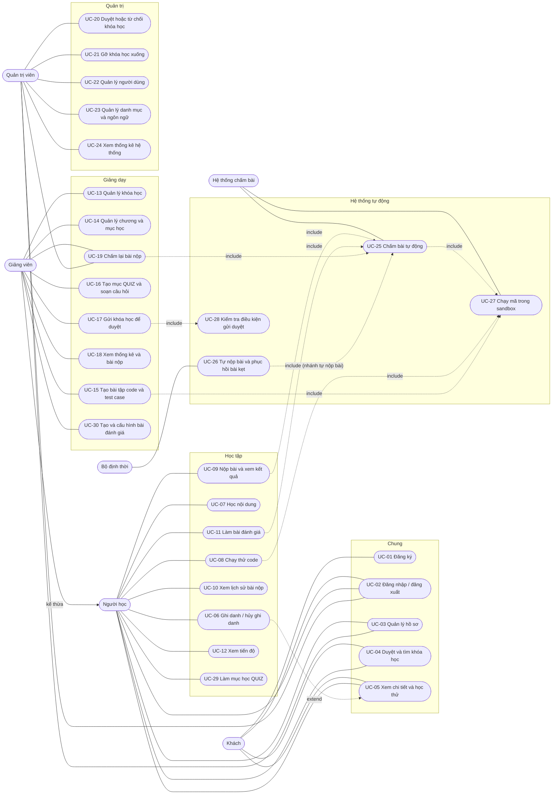

# CodePath — Đặc tả Use case

**Đề tài:** Phát triển nền tảng học lập trình trực tuyến tích hợp môi trường thực hành và đánh giá

| | |
|---|---|
| **Phiên bản** | 1.1 |
| **Tài liệu liên quan** | `requirements.md` (v1.1) |

> Các mã **FR-xx**, **BR-xx**, **NFR-xx**, **AC-xx** và tham chiếu **§x.x** trong tài liệu này trỏ đến file `requirements.md`.

**Thay đổi chính so với v1.0**

| Nội dung | Thay đổi |
|---|---|
| Sơ đồ | Thêm UC-27, UC-28, UC-29, UC-30; sửa quan hệ extend/include; thêm generalization Giảng viên kế thừa Người học |
| UC-07, UC-16 | Viết đặc tả chi tiết; UC-16 chỉ còn phạm vi mục QUIZ |
| UC-29, UC-30 | Mới: làm mục QUIZ; tạo và cấu hình bài đánh giá |
| UC-27, UC-28 | Mới: chạy mã trong sandbox; kiểm tra điều kiện gửi duyệt |
| UC-06, 08, 09, 11, 15, 17, 19, 25, 26 | Cập nhật theo các quy tắc mới ở requirements v1.1 |

## Mục lục

1. [Tác nhân (Actor)](#1-tác-nhân-actor)
2. [Sơ đồ use case](#2-sơ-đồ-use-case)
3. [Danh sách use case](#3-danh-sách-use-case)
4. [Đặc tả chi tiết](#4-đặc-tả-chi-tiết)
5. [Các use case còn lại (tóm tắt)](#5-các-use-case-còn-lại-tóm-tắt)

---

## 1. Tác nhân (Actor)

| Tác nhân | Loại | Mô tả |
|---|---|---|
| Khách (Guest) | Chính | Người chưa đăng nhập; được đăng ký, đăng nhập, duyệt và xem khóa học. |
| Người học (Learner) | Chính | Người dùng đã đăng nhập; có các use case học tập, và xem khóa học (UC-04, UC-05) như Khách. Không dùng UC-01 vì đã có tài khoản. |
| Giảng viên (Instructor) | Chính | Tạo nội dung và theo dõi người học; kế thừa các use case của Người học để học khóa học của giảng viên khác (§2, không ghi danh khóa của mình). |
| Quản trị viên (Admin) | Chính | Kiểm duyệt và vận hành hệ thống. Không kế thừa Người học (không ghi danh, không học). |
| Hệ thống chấm bài (Judge Worker) | Phụ (hệ thống) | Chạy mã trong sandbox (chạy thử, chấm bài, kiểm tra lời giải tham chiếu) và ghi kết quả chấm. |
| Bộ định thời (Scheduler) | Phụ (hệ thống) | Tự nộp bài đánh giá khi hết giờ và phục hồi bài nộp bị kẹt. |

## 2. Sơ đồ use case

## 3. Danh sách use case

| ID | Use case | Tác nhân chính | Yêu cầu liên quan |
|---|---|---|---|
| UC-01 | Đăng ký tài khoản | Khách | FR-01 |
| UC-02 | Đăng nhập / đăng xuất | Mọi người dùng | FR-01, FR-02 |
| UC-03 | Xem và cập nhật hồ sơ, đổi mật khẩu | Người học, Giảng viên, Admin | FR-02, FR-05 |
| UC-04 | Duyệt, tìm kiếm, lọc khóa học | Khách, Người học | FR-07, FR-08 |
| UC-05 | Xem chi tiết khóa học và mục học xem thử | Khách, Người học | FR-09, FR-24 |
| UC-06 | Ghi danh và hủy ghi danh khóa học | Người học | FR-23 |
| UC-07 | Học nội dung và đánh dấu hoàn thành | Người học | FR-24, FR-25 |
| UC-08 | Chạy thử code | Người học (đã đăng nhập) | FR-26, FR-27, FR-31 |
| UC-09 | Nộp bài và xem kết quả chấm | Người học | FR-28, FR-29, FR-31 |
| UC-10 | Xem lịch sử bài nộp | Người học | FR-30 |
| UC-11 | Làm bài đánh giá | Người học | FR-33, FR-34 |
| UC-12 | Xem tiến độ và bảng tổng hợp cá nhân | Người học | FR-25, FR-37 |
| UC-13 | Tạo, sửa, xóa khóa học | Giảng viên | FR-10, FR-17 |
| UC-14 | Quản lý chương và mục học | Giảng viên | FR-11 |
| UC-15 | Tạo bài tập code và quản lý test case | Giảng viên | FR-12, FR-13, FR-14 |
| UC-16 | Tạo mục QUIZ và soạn câu hỏi | Giảng viên | FR-15 |
| UC-17 | Gửi khóa học để duyệt | Giảng viên | FR-17 |
| UC-18 | Xem thống kê khóa học và bài nộp của người học | Giảng viên | FR-35, FR-36 |
| UC-19 | Chấm lại bài nộp | Giảng viên, Admin | FR-32 |
| UC-20 | Duyệt hoặc từ chối khóa học | Admin | FR-18 |
| UC-21 | Gỡ khóa học xuống (lưu trữ) | Admin | FR-19 |
| UC-22 | Quản lý người dùng | Admin | FR-04, FR-06 |
| UC-23 | Quản lý danh mục và ngôn ngữ lập trình | Admin | FR-20, FR-21 |
| UC-24 | Xem thống kê hệ thống | Admin | FR-22 |
| UC-25 | Chấm bài tự động | Hệ thống chấm bài | FR-28, FR-34 |
| UC-26 | Tự nộp bài khi hết giờ và phục hồi bài nộp bị kẹt | Bộ định thời | FR-32, FR-33 |
| UC-27 | Chạy mã trong sandbox | Hệ thống chấm bài | FR-14, FR-27, FR-28 |
| UC-28 | Kiểm tra điều kiện gửi duyệt | (nội bộ, do UC-17 gọi) | FR-17 |
| UC-29 | Làm mục học QUIZ | Người học | FR-38 |
| UC-30 | Tạo và cấu hình bài đánh giá | Giảng viên | FR-16 |

**Quan hệ giữa các use case**

| Quan hệ | Mô tả |
|---|---|
| Giảng viên kế thừa Người học | Giảng viên dùng được các use case học tập đối với khóa học của giảng viên khác. |
| UC-09 «include» UC-25 | Mỗi lần nộp bài đều dẫn đến chấm tự động. |
| UC-11 «include» UC-25 | Phần code của bài đánh giá được chấm tự động. |
| UC-19 «include» UC-25 | Chấm lại đưa bài nộp vào hàng đợi chấm và tạo bản ghi kết quả mới (BR-11). |
| UC-26 «include» UC-25 | Chỉ ở nhánh tự nộp bài đánh giá. Bài nộp kẹt `RUNNING` chỉ chuyển `INTERNAL_ERROR`; bài `QUEUED` kẹt được đưa lại hàng đợi (§3.3). |
| UC-25 «include» UC-27 | Mỗi test case được chạy trong sandbox. |
| UC-08 «include» UC-27 | Chạy thử dùng cùng sandbox với chấm bài. |
| UC-15 «include» UC-27 | Chạy lời giải tham chiếu để xác nhận đạt toàn bộ test case. |
| UC-17 «include» UC-28 | Kiểm tra điều kiện gửi duyệt theo §3.2. |
| UC-06 «extend» UC-05 | Từ trang chi tiết khóa học, người dùng có thể chọn ghi danh (điểm mở rộng: trang chi tiết). |

Ghi chú: UC-07 điều hướng sang UC-08, UC-09 (mục CODING) và UC-29 (mục QUIZ) nhưng không phải quan hệ include/extend.

## 4. Đặc tả chi tiết

### UC-01 — Đăng ký tài khoản

| Mục | Nội dung |
|---|---|
| **Tác nhân** | Khách |
| **Mô tả** | Khách tạo tài khoản mới để học hoặc giảng dạy. |
| **Tiền điều kiện** | Khách chưa đăng nhập. |
| **Hậu điều kiện** | Tài khoản mới ở trạng thái hoạt động; người dùng đã đăng nhập. |
| **Luồng chính** | 1. Khách mở trang đăng ký. 2. Nhập email, mật khẩu, tên hiển thị và chọn vai trò (`LEARNER` hoặc `INSTRUCTOR`). 3. Hệ thống kiểm tra dữ liệu và tính duy nhất của email. 4. Hệ thống lưu mật khẩu dạng băm và tạo tài khoản. 5. Hệ thống đăng nhập và chuyển đến trang chủ. |
| **Luồng thay thế / ngoại lệ** | 3a. Email đã tồn tại → báo lỗi, giữ lại dữ liệu đã nhập. 3b. Mật khẩu dưới 8 ký tự hoặc dữ liệu sai định dạng → báo lỗi từng trường. 3c. Vai trò là `ADMIN` hoặc giá trị lạ → từ chối (400). \*. Vượt giới hạn tần suất → lỗi 429. |
| **Quy tắc liên quan** | NFR-01, NFR-03, NFR-06; AC-31 |

### UC-02 — Đăng nhập / đăng xuất

| Mục | Nội dung |
|---|---|
| **Tác nhân** | Mọi người dùng |
| **Tiền điều kiện** | Đã có tài khoản. |
| **Hậu điều kiện** | Đăng nhập: người dùng có phiên hợp lệ (cơ chế token theo NFR-05). Đăng xuất: phiên bị thu hồi. |
| **Luồng chính** | 1. Người dùng nhập email và mật khẩu. 2. Hệ thống xác thực và kiểm tra tài khoản còn hoạt động. 3. Hệ thống cấp phiên đăng nhập. 4. Người dùng được chuyển đến trang phù hợp với vai trò. 5. Khi đăng xuất, hệ thống thu hồi phiên và xóa trạng thái đăng nhập phía client. |
| **Luồng thay thế / ngoại lệ** | 2a. Sai email hoặc mật khẩu → thông báo chung "thông tin không đúng" (không tiết lộ email có tồn tại). 2b. Tài khoản bị vô hiệu hóa → từ chối đăng nhập. 2c. Quá nhiều lần thử → 429. \*. Phiên hết hạn → client tự làm mới; không làm mới được → yêu cầu đăng nhập lại. |
| **Quy tắc liên quan** | NFR-05, NFR-06; AC-30, AC-41 |

### UC-06 — Ghi danh và hủy ghi danh khóa học

| Mục | Nội dung |
|---|---|
| **Tác nhân** | Người học (hoặc Giảng viên với khóa của người khác) |
| **Tiền điều kiện** | Đã đăng nhập; khóa học ở trạng thái `PUBLISHED` (khi ghi danh). |
| **Hậu điều kiện** | Ghi danh: tồn tại đúng một bản ghi `(người dùng, khóa học)`; tiến độ hiển thị theo dữ liệu đã lưu (0% nếu ghi danh lần đầu, khôi phục tiến độ cũ nếu từng ghi danh). Hủy: bản ghi ghi danh bị xóa, tiến độ và bài nộp vẫn được lưu (§3.5). |
| **Luồng chính (ghi danh)** | 1. Người dùng nhấn "Ghi danh" ở trang chi tiết khóa học. 2. Hệ thống kiểm tra khóa học đang `PUBLISHED` và người dùng không phải chủ khóa học. 3. Hệ thống tạo ghi danh. 4. Hệ thống chuyển người dùng đến trang học của khóa học. |
| **Luồng hủy ghi danh** | H1. Người học chọn "Hủy ghi danh". H2. Hệ thống xác nhận; nếu khóa học là `ARCHIVED`, cảnh báo rằng sau khi hủy sẽ không ghi danh lại được. H3. Hệ thống xóa ghi danh; tiến độ và bài nộp được giữ lại. |
| **Luồng thay thế / ngoại lệ** | 2a. Khóa học không còn `PUBLISHED` → báo lỗi, không ghi danh. 2b. Người dùng là chủ khóa học → từ chối (403). 3a. Đã ghi danh (kể cả yêu cầu đồng thời) → ràng buộc unique chặn bản ghi trùng; trả về ghi danh hiện có. H2a. Đang có lần làm bài đánh giá `IN_PROGRESS` → chưa quyết định (xem câu hỏi mở ở requirements §10). |
| **Quy tắc liên quan** | BR-01, BR-04, BR-06; FR-23; AC-09, AC-10, AC-14 |

### UC-07 — Học nội dung và đánh dấu hoàn thành

| Mục | Nội dung |
|---|---|
| **Tác nhân** | Người học |
| **Mô tả** | Người học duyệt đề cương và học từng mục. Mục TEXT, VIDEO học trực tiếp; mục CODING và QUIZ chuyển sang use case riêng. |
| **Tiền điều kiện** | Đã đăng nhập và đã ghi danh khóa học `PUBLISHED` hoặc `ARCHIVED`; hoặc mục được mở là mục xem thử. |
| **Hậu điều kiện** | Tiến độ mục được cập nhật khi đánh dấu hoàn thành; phần trăm tiến độ khóa học được tính lại. |
| **Luồng chính** | 1. Người học mở trang học, xem đề cương theo chương và mục kèm trạng thái hoàn thành. 2. Người học chọn một mục. 3. Hệ thống kiểm tra quyền truy cập theo ID mục (BR-05). 4. Hệ thống hiển thị theo loại mục: TEXT (Markdown đã làm sạch), VIDEO (liên kết ngoài), CODING (chuyển sang UC-08, UC-09), QUIZ (chuyển sang UC-29). 5. Với mục TEXT, VIDEO, người học nhấn "Đánh dấu hoàn thành". 6. Hệ thống lưu tiến độ theo `(người học, mục học)` và tính lại phần trăm tiến độ khóa học. |
| **Luồng thay thế / ngoại lệ** | 3a. Chưa ghi danh và mục không phải xem thử → 403, không trả nội dung. 3b. Khóa học không tồn tại hoặc không `PUBLISHED` và người dùng chưa ghi danh → 404. 4a. Mục đã bị giảng viên xóa trong lúc đang mở → báo mục không còn tồn tại, quay về đề cương. 5a. Đánh dấu lặp lại → idempotent, không tạo bản ghi trùng. 6a. Giảng viên thêm hoặc xóa mục trong khi người học đang học → phần trăm tiến độ tính lại theo tổng mới (§3.5). |
| **Quy tắc liên quan** | BR-05, BR-06, NFR-08, NFR-13, §3.5; FR-24, FR-25; AC-01, AC-11, AC-24 |

### UC-08 — Chạy thử code

| Mục | Nội dung |
|---|---|
| **Tác nhân** | Người học (đã đăng nhập); hệ thống chấm bài (phụ) |
| **Tiền điều kiện** | Đã đăng nhập; đã ghi danh khóa học chứa bài tập, hoặc bài tập nằm trong mục xem thử (Khách phải đăng nhập mới được chạy thử). |
| **Hậu điều kiện** | Hiển thị kết quả chạy; **không** tạo bài nộp, không ảnh hưởng điểm hay tiến độ. |
| **Luồng chính** | 1. Người học mở bài tập, chọn ngôn ngữ và viết code trong trình soạn (nháp tự động lưu). 2. Người học nhấn "Chạy thử", chọn test mẫu hoặc nhập đầu vào tùy chọn. 3. Hệ thống kiểm tra quyền, độ dài mã và giới hạn tần suất. 4. Hệ thống thực thi mã trong sandbox (UC-27). 5. Hệ thống trả về stdout, stderr, thời gian và bộ nhớ sử dụng. |
| **Luồng thay thế / ngoại lệ** | 3a. Mã vượt 64 KB hoặc ngôn ngữ không được bật → từ chối (BR-13). 3b. Vượt giới hạn tần suất → 429. 4a. Lỗi biên dịch → hiển thị thông báo lỗi. 4b. Quá thời gian, quá bộ nhớ hoặc quá đầu ra → hiển thị loại lỗi tương ứng. 4c. Sandbox không khả dụng → thông báo "hệ thống bận, thử lại sau". |
| **Quy tắc liên quan** | BR-05, BR-10, BR-13, BR-14; AC-12, AC-13, AC-17, AC-18 |

### UC-09 — Nộp bài và xem kết quả chấm

| Mục | Nội dung |
|---|---|
| **Tác nhân** | Người học; hệ thống chấm bài (phụ) |
| **Tiền điều kiện** | Đã ghi danh; bài tập thuộc khóa học `PUBLISHED` hoặc `ARCHIVED` mà người học đã ghi danh. |
| **Hậu điều kiện** | Có bản ghi bài nộp với verdict và điểm; tiến độ cập nhật nếu `ACCEPTED`. |
| **Luồng chính** | 1. Người học nhấn "Nộp bài". 2. Hệ thống kiểm tra quyền, ngôn ngữ, kích thước mã và giới hạn tần suất. 3. Hệ thống tạo bài nộp `QUEUED`, đưa vào hàng đợi và phản hồi ngay. 4. Giao diện hiển thị trạng thái đang chờ, cập nhật tự động. 5. Hệ thống chấm bài (UC-25) chạy các test case và ghi kết quả. 6. Giao diện hiển thị verdict, điểm và kết quả từng test: test công khai kèm đầu vào/ra, test ẩn chỉ hiển thị đạt hoặc không đạt. 7. Nếu `ACCEPTED`, mục học được đánh dấu hoàn thành. |
| **Luồng thay thế / ngoại lệ** | 2a. Quá giới hạn tần suất → 429. 2b. Mã không hợp lệ (quá dài, ngôn ngữ bị tắt) → từ chối. 5a. Lỗi biên dịch → `COMPILE_ERROR`, điểm 0. 5b. Có test không đạt → verdict theo quy tắc ở §3.3 (`PARTIAL`, `WRONG_ANSWER` hoặc loại lỗi của test không đạt đầu tiên: `RUNTIME_ERROR`, `TIME_LIMIT_EXCEEDED`, `MEMORY_LIMIT_EXCEEDED`, `OUTPUT_LIMIT_EXCEEDED`); điểm bằng tổng trọng số các test đã đạt. 5c. Lỗi hệ thống chấm → `INTERNAL_ERROR`, không tính vào lần nộp của người học, có thể chấm lại (UC-19, UC-26). \*. Client gửi kèm điểm hoặc verdict → bỏ qua (BR-08). |
| **Quy tắc liên quan** | BR-08, BR-09, BR-11, BR-12, BR-14; AC-15 – AC-24, AC-44 |

### UC-11 — Làm bài đánh giá

| Mục | Nội dung |
|---|---|
| **Tác nhân** | Người học; hệ thống chấm bài, bộ định thời (phụ) |
| **Tiền điều kiện** | Đã ghi danh; bài đánh giá đang trong khoảng ngày mở/đóng; còn lượt làm. |
| **Hậu điều kiện** | Lần làm ở trạng thái `GRADED` với điểm của lần làm; điểm bài đánh giá được cập nhật thành điểm cao nhất các lần làm (BR-19). Code trong bài đánh giá không tạo bài nộp ở UC-10 và không đổi tiến độ hay điểm mục CODING. |
| **Luồng chính (bắt đầu và nộp)** | 1. Người học nhấn "Bắt đầu"; hệ thống ghi thời điểm bắt đầu và tính hạn nộp theo đồng hồ máy chủ (sớm hơn giữa bắt đầu + thời lượng và ngày đóng). 2. Hệ thống hiển thị câu hỏi (xáo trộn nếu cấu hình) và đồng hồ đếm ngược. 3. Người học trả lời, viết code; hệ thống tự lưu nháp định kỳ. 4. Người học nhấn "Nộp bài" (hoặc hết giờ, hệ thống tự nộp bằng nội dung đã lưu, UC-26). 5. Hệ thống chấm trắc nghiệm ngay, gửi phần code vào hàng đợi chấm (UC-25). 6. Khi mọi phần đã chấm, lần làm chuyển `GRADED`; người học xem điểm và kết quả theo §3.4. |
| **Luồng tiếp tục làm bài** | T1. Người học quay lại khi có lần làm `IN_PROGRESS` (mất kết nối, đóng tab). T2. Hệ thống khôi phục nháp đã lưu; đồng hồ vẫn tính theo máy chủ. T3. Tiếp tục từ bước 3 của luồng chính. |
| **Luồng thay thế / ngoại lệ** | 1a. Hết lượt làm → từ chối. Đang có lần làm `IN_PROGRESS` → chuyển sang "Luồng tiếp tục làm bài". 1b. Ngoài khoảng ngày mở/đóng → từ chối. 4a. Nội dung gửi sau hạn (quá 10 giây du di) → bị bỏ qua, hệ thống nộp bằng nháp đã lưu. 4b. Người học nộp trùng thời điểm bộ định thời tự nộp → chỉ ghi nhận một lần nộp (idempotent). 6a. Phần code gặp `INTERNAL_ERROR` → lần làm giữ nguyên chờ chấm lại (UC-19), chưa chuyển `GRADED`. \*. Rời tab → ghi log sự kiện (không tự động xử phạt). |
| **Quy tắc liên quan** | BR-15, BR-16, BR-17, BR-19; AC-25 – AC-28, AC-40 |

### UC-15 — Tạo bài tập code và quản lý test case

| Mục | Nội dung |
|---|---|
| **Tác nhân** | Giảng viên; hệ thống chấm bài (phụ) |
| **Tiền điều kiện** | Giảng viên đăng nhập, sở hữu khóa học; khóa học ở `DRAFT`, `REJECTED` hoặc `PUBLISHED` (các trạng thái cho phép sửa, §3.2). |
| **Hậu điều kiện** | Bài tập được lưu, kèm test case và lời giải tham chiếu đã được kiểm chứng. |
| **Luồng chính** | 1. Giảng viên thêm mục học loại CODING vào một chương. 2. Nhập đề bài (Markdown), chọn ngôn ngữ cho phép, mã khởi tạo, giới hạn thời gian/bộ nhớ, gợi ý. 3. Thêm test case: đầu vào, đầu ra mong đợi, trọng số, công khai hoặc ẩn. 4. Nhập lời giải tham chiếu cho từng ngôn ngữ được phép và nhấn "Kiểm tra". 5. Hệ thống chạy lời giải qua toàn bộ test case trong sandbox (UC-27) và hiển thị kết quả. 6. Giảng viên lưu bài tập. |
| **Luồng thay thế / ngoại lệ** | 2a. Giới hạn vượt mức tối đa của hệ thống (10 giây, 512 MB) → từ chối. 5a. Lời giải không đạt toàn bộ test → hiển thị test lỗi; khóa học `DRAFT`/`REJECTED`: lưu được ở dạng nháp nhưng **không đủ điều kiện gửi duyệt**. 6a. Sửa test case hoặc đề bài khi đã có bài nộp → hệ thống cảnh báo trước khi lưu; bài nộp cũ giữ nguyên kết quả (§3.2). 6b. Khóa học đang `PUBLISHED` (sửa không cần duyệt lại): không cho lưu nếu bài tập không còn test ẩn hoặc lời giải tham chiếu không còn đạt toàn bộ test (§3.2). \*a. Khóa học thuộc giảng viên khác → 403. \*b. Khóa học ở `PENDING_REVIEW` hoặc `ARCHIVED` → không cho sửa. |
| **Quy tắc liên quan** | BR-02, BR-09, BR-10; FR-14; AC-04, AC-05, AC-06, AC-43 |

### UC-16 — Tạo mục QUIZ và soạn câu hỏi

| Mục | Nội dung |
|---|---|
| **Tác nhân** | Giảng viên |
| **Mô tả** | Giảng viên tạo mục học loại QUIZ và soạn bộ câu hỏi trắc nghiệm dùng để luyện tập. |
| **Tiền điều kiện** | Giảng viên đăng nhập, sở hữu khóa học ở `DRAFT`, `REJECTED` hoặc `PUBLISHED` (các trạng thái cho phép sửa, §3.2). |
| **Hậu điều kiện** | Mục QUIZ được lưu kèm bộ câu hỏi hợp lệ và điểm đạt. |
| **Luồng chính** | 1. Giảng viên thêm mục học loại QUIZ vào một chương. 2. Nhập tiêu đề và điểm đạt (mặc định 70%). 3. Thêm câu hỏi: nội dung (Markdown), loại (một đáp án hoặc nhiều đáp án), các lựa chọn, đáp án đúng, giải thích. 4. Sửa, xóa, sắp xếp lại câu hỏi. 5. Giảng viên lưu; hệ thống kiểm tra tính hợp lệ của từng câu. |
| **Luồng thay thế / ngoại lệ** | 3a. Câu hỏi có dưới 2 lựa chọn → không cho lưu. 3b. Câu hỏi không có đáp án đúng → không cho lưu. 3c. Câu một đáp án nhưng đánh dấu nhiều đáp án đúng → không cho lưu. 5a. Khóa học `DRAFT`/`REJECTED`: mục QUIZ chưa có câu hỏi nào → lưu được ở dạng nháp nhưng **không đủ điều kiện gửi duyệt**. 5b. Khóa học `PUBLISHED`: không cho lưu nếu mục QUIZ không còn câu hỏi hợp lệ (§3.2). 5c. Sửa câu hỏi khi đã có người học làm → cảnh báo trước khi lưu; kết quả cũ giữ nguyên. \*a. Khóa học thuộc giảng viên khác → 403. \*b. Khóa học ở `PENDING_REVIEW` hoặc `ARCHIVED` → không cho sửa. |
| **Quy tắc liên quan** | BR-02, BR-18; FR-15; AC-38, AC-43 |

### UC-17 — Gửi khóa học để duyệt

| Mục | Nội dung |
|---|---|
| **Tác nhân** | Giảng viên |
| **Tiền điều kiện** | Giảng viên sở hữu khóa học; khóa học ở `DRAFT` hoặc `REJECTED`. |
| **Hậu điều kiện** | Khóa học ở `PENDING_REVIEW` và bị khóa chỉnh sửa. |
| **Luồng chính** | 1. Giảng viên nhấn "Gửi duyệt". 2. Hệ thống kiểm tra điều kiện gửi duyệt (UC-28). 3. Hệ thống chuyển trạng thái sang `PENDING_REVIEW`. |
| **Luồng thay thế / ngoại lệ** | 1a. Khóa học đang `PENDING_REVIEW`, `PUBLISHED` hoặc `ARCHIVED` → không cho gửi. 2a. UC-28 báo thiếu điều kiện → liệt kê cụ thể từng mục còn thiếu, giữ nguyên trạng thái. |
| **Quy tắc liên quan** | BR-02, §3.2; AC-04, AC-06 |

### UC-19 — Chấm lại bài nộp

| Mục | Nội dung |
|---|---|
| **Tác nhân** | Giảng viên (bài nộp trong khóa học của mình), Admin (toàn hệ thống) |
| **Tiền điều kiện** | Bài nộp tồn tại và đang ở `INTERNAL_ERROR` (FR-32). |
| **Hậu điều kiện** | Có bản ghi kết quả mới, ghi nhận người thực hiện; điểm và tiến độ được cập nhật theo BR-12. |
| **Luồng chính** | 1. Người thực hiện mở danh sách bài nộp `INTERNAL_ERROR`: Giảng viên trong khóa học của mình (UC-18); Admin trên toàn hệ thống. 2. Người thực hiện chọn một bài nộp và nhấn "Chấm lại"; hệ thống kiểm tra quyền (giảng viên chỉ với khóa học của mình). 3. Hệ thống đưa bài nộp vào hàng đợi chấm (UC-25). 4. Kết quả mới được ghi, bản ghi cũ được giữ lại. |
| **Luồng thay thế / ngoại lệ** | 2a. Không có quyền → 403. 2b. Bài nộp không ở `INTERNAL_ERROR` → từ chối. 4a. Phần code của lần làm bài đánh giá (UC-11) được chấm lại theo cùng luồng; khi mọi phần đã chấm, lần làm chuyển `GRADED`. \*. Chấm lại hàng loạt khi sửa test case: ngoài phạm vi (xem câu hỏi mở số 2 ở requirements §10). |
| **Quy tắc liên quan** | BR-07, BR-11; FR-32; AC-23 |

### UC-20 — Duyệt hoặc từ chối khóa học

| Mục | Nội dung |
|---|---|
| **Tác nhân** | Admin |
| **Tiền điều kiện** | Admin đăng nhập; có khóa học ở `PENDING_REVIEW`. |
| **Hậu điều kiện** | Khóa học chuyển `PUBLISHED` hoặc `REJECTED` (kèm lý do). |
| **Luồng chính** | 1. Admin mở danh sách khóa học chờ duyệt. 2. Admin xem nội dung khóa học, bài tập và test case (BR-05). 3. Admin chọn "Duyệt"; hệ thống chuyển khóa học sang `PUBLISHED`. |
| **Luồng thay thế / ngoại lệ** | 3a. Admin chọn "Từ chối" và nhập lý do (10–1000 ký tự) → khóa học chuyển `REJECTED`; giảng viên xem được lý do và gửi lại. 3b. Lý do thiếu hoặc không hợp lệ → từ chối thao tác. 3c. Khóa học đã được xử lý bởi admin khác (trạng thái đổi) → thông báo xung đột, tải lại. |
| **Quy tắc liên quan** | BR-03, BR-05; AC-07, AC-08, AC-45 |

### UC-22 — Quản lý người dùng

| Mục | Nội dung |
|---|---|
| **Tác nhân** | Admin |
| **Tiền điều kiện** | Admin đăng nhập. |
| **Hậu điều kiện** | Trạng thái tài khoản được cập nhật; token của tài khoản bị vô hiệu hóa không còn hiệu lực. |
| **Luồng chính** | 1. Admin tìm kiếm và lọc người dùng theo vai trò, trạng thái. 2. Admin chọn một tài khoản và nhấn "Vô hiệu hóa" (hoặc "Kích hoạt lại"). 3. Hệ thống cập nhật cờ `isActive`; từ yêu cầu kế tiếp, token của tài khoản đó bị từ chối. |
| **Luồng thay thế / ngoại lệ** | 2a. Admin vô hiệu hóa chính mình hoặc quản trị viên hoạt động cuối cùng → từ chối. 3a. Vô hiệu hóa giảng viên có khóa học `PUBLISHED` → chưa quyết định cách xử lý khóa học (xem câu hỏi mở ở requirements §10). |
| **Quy tắc liên quan** | FR-04, FR-06, NFR-05; AC-30, AC-32 |

### UC-25 — Chấm bài tự động

| Mục | Nội dung |
|---|---|
| **Tác nhân** | Hệ thống chấm bài |
| **Tiền điều kiện** | Có bài nộp `QUEUED` trong hàng đợi. |
| **Hậu điều kiện** | Bài nộp có verdict cuối, điểm và kết quả từng test. |
| **Luồng chính** | 1. Worker lấy một bài nộp và chuyển trạng thái `RUNNING`. 2. Với từng test case, worker thực thi mã trong sandbox mới (UC-27) với đầu vào của test. 3. Worker so sánh đầu ra với kỳ vọng, ghi kết quả từng test (đạt, sai, lỗi, quá giới hạn). 4. Worker tính điểm theo trọng số và xác định verdict cuối theo quy tắc ưu tiên ở §3.3. 5. Worker lưu kết quả trong một transaction và cập nhật tiến độ nếu `ACCEPTED`. 6. Giao diện của người học nhận cập nhật. |
| **Luồng thay thế / ngoại lệ** | 2a. Lỗi biên dịch → dừng, verdict `COMPILE_ERROR`. 2b. Sandbox lỗi hạ tầng → thử lại có giới hạn; vẫn lỗi thì `INTERNAL_ERROR`. 5a. Bài nộp đã bị chuyển trạng thái khác (ví dụ `INTERNAL_ERROR` do UC-26) trong lúc chấm → bỏ kết quả đến muộn (§3.3). \*. Công việc bị xử lý lặp (retry) → idempotent, không tạo kết quả trùng. |
| **Quy tắc liên quan** | BR-08, BR-10, BR-11, NFR-07, NFR-10, NFR-11, §3.3; AC-44 |

### UC-26 — Tự nộp bài khi hết giờ và phục hồi bài nộp bị kẹt

| Mục | Nội dung |
|---|---|
| **Tác nhân** | Bộ định thời |
| **Tiền điều kiện** | Có lần làm bài đánh giá quá hạn ở `IN_PROGRESS`; hoặc bài nộp ở `RUNNING` quá 2 phút; hoặc bài nộp ở `QUEUED` quá 5 phút (§3.3). |
| **Hậu điều kiện** | Lần làm quá hạn được chuyển `SUBMITTED` và đưa vào chấm; bài nộp `RUNNING` kẹt chuyển `INTERNAL_ERROR`; bài `QUEUED` kẹt được đưa lại vào hàng đợi (tối đa 3 lần, vượt quá thì `INTERNAL_ERROR`). |
| **Luồng chính** | 1. Bộ định thời quét định kỳ (ví dụ mỗi 30 giây). 2. Với mỗi lần làm quá hạn, hệ thống tự nộp bằng nội dung nháp mới nhất; phần code được đưa vào chấm (UC-25). 3. Với mỗi bài nộp `RUNNING` kẹt, hệ thống chuyển thành `INTERNAL_ERROR` và ghi log (chấm lại bằng UC-19). 4. Với mỗi bài nộp `QUEUED` kẹt, hệ thống đưa lại vào hàng đợi; vượt số lần cho phép thì chuyển `INTERNAL_ERROR`. |
| **Luồng thay thế / ngoại lệ** | 2a. Người học đã tự nộp cùng lúc → bỏ qua, chỉ một lần nộp được ghi nhận (idempotent). 3a. Kết quả chấm đến muộn sau khi bài đã chuyển `INTERNAL_ERROR` → bị bỏ qua (§3.3). \*. Bộ định thời lỗi giữa chừng → lần quét kế tiếp xử lý tiếp các mục còn lại. |
| **Quy tắc liên quan** | BR-11, BR-15, §3.3, NFR-11; AC-23, AC-25 |

### UC-27 — Chạy mã trong sandbox

| Mục | Nội dung |
|---|---|
| **Tác nhân** | Hệ thống chấm bài |
| **Mô tả** | Thực thi mã không đáng tin cậy trong môi trường cô lập và trả về kết quả chạy. Dùng chung cho chạy thử (UC-08), chấm bài (UC-25) và kiểm tra lời giải tham chiếu (UC-15). |
| **Tiền điều kiện** | Có yêu cầu thực thi gồm mã nguồn, ngôn ngữ đã bật, đầu vào và giới hạn thời gian/bộ nhớ. |
| **Hậu điều kiện** | Có kết quả chạy (stdout, stderr, thời gian, bộ nhớ, loại lỗi nếu có); container đã bị hủy. |
| **Luồng chính** | 1. Hệ thống nhận yêu cầu, kiểm tra ngôn ngữ và kích thước mã. 2. Tạo container mới theo ràng buộc §3.6 (không mạng, không root, giới hạn tài nguyên). 3. Biên dịch (nếu cần). 4. Chạy với đầu vào và giới hạn đã cho. 5. Thu kết quả, hủy container, trả kết quả cho use case gọi. |
| **Luồng thay thế / ngoại lệ** | 1a. Mã vượt 64 KB hoặc ngôn ngữ không được bật → từ chối (BR-13). 3a. Lỗi biên dịch → trả `COMPILE_ERROR` kèm thông báo. 4a. Quá thời gian, quá bộ nhớ, quá đầu ra hoặc quá số tiến trình → trả loại lỗi tương ứng. 4b. Runner không khả dụng → trả lỗi hạ tầng cho use case gọi (UC-08 hiển thị "hệ thống bận"; UC-25 thử lại rồi `INTERNAL_ERROR`). |
| **Quy tắc liên quan** | BR-10, BR-13, §3.6, NFR-07; AC-17, AC-18 |

### UC-28 — Kiểm tra điều kiện gửi duyệt

| Mục | Nội dung |
|---|---|
| **Tác nhân** | (nội bộ, do UC-17 gọi) |
| **Mô tả** | Kiểm tra khóa học đủ điều kiện gửi duyệt theo §3.2 và trả danh sách điều kiện còn thiếu. |
| **Tiền điều kiện** | Khóa học ở `DRAFT` hoặc `REJECTED`. |
| **Hậu điều kiện** | Có kết quả đạt hoặc không đạt kèm danh sách mục thiếu; không đổi trạng thái khóa học. |
| **Luồng chính** | 1. Kiểm tra đủ tiêu đề, mô tả, danh mục. 2. Kiểm tra có ít nhất một chương và mỗi chương có ít nhất một mục học. 3. Với mỗi bài CODING, kiểm tra có ít nhất một test case ẩn. 4. Với mỗi bài CODING, kiểm tra lời giải tham chiếu của từng ngôn ngữ được phép đã đạt toàn bộ test case hiện tại (chạy lại qua UC-27 hay dùng kết quả kiểm chứng đã lưu: chưa quyết định, xem requirements §10). 5. Với mỗi mục QUIZ, kiểm tra có ít nhất một câu hỏi hợp lệ. 6. Trả kết quả đạt. |
| **Luồng thay thế / ngoại lệ** | 1a – 5a. Thiếu điều kiện nào → ghi vào danh sách; sau khi kiểm tra hết, trả kết quả không đạt kèm danh sách đầy đủ. |
| **Quy tắc liên quan** | BR-02, §3.2; AC-06 |

### UC-29 — Làm mục học QUIZ

| Mục | Nội dung |
|---|---|
| **Tác nhân** | Người học |
| **Mô tả** | Người học trả lời bộ câu hỏi trắc nghiệm của một mục QUIZ để luyện tập. Hệ thống chấm ngay, cho phép làm lại không giới hạn. |
| **Tiền điều kiện** | Đã đăng nhập; đã ghi danh khóa học `PUBLISHED` hoặc `ARCHIVED`; mục QUIZ có ít nhất một câu hỏi. |
| **Hậu điều kiện** | Có bản ghi lần làm kèm điểm; điểm của mục là điểm cao nhất các lần làm; mục được đánh dấu hoàn thành nếu điểm từ điểm đạt của mục trở lên. |
| **Luồng chính** | 1. Người học mở mục QUIZ. 2. Hệ thống hiển thị các câu hỏi, không kèm đáp án đúng. 3. Người học chọn đáp án (một hoặc nhiều tùy loại câu). 4. Người học nhấn "Nộp". 5. Hệ thống kiểm tra quyền rồi chấm ngay: câu đúng khi chọn chính xác tập đáp án đúng; điểm bằng phần trăm số câu đúng (BR-18). 6. Hệ thống hiển thị điểm, đúng/sai từng câu, giải thích và đáp án đúng (ngoại lệ của BR-09 dành cho mục QUIZ). 7. Nếu điểm đạt từ điểm đạt của mục trở lên, mục được đánh dấu hoàn thành. |
| **Luồng thay thế / ngoại lệ** | 2a. Mục là xem thử và người dùng chưa ghi danh → chỉ xem câu hỏi, yêu cầu ghi danh để nộp. 4a. Bỏ trống câu → vẫn cho nộp, câu bỏ trống tính sai, có cảnh báo trước khi nộp. 5a. Client gửi kèm điểm hoặc đúng/sai → bỏ qua (BR-08). 6a. Điểm chưa đạt → thông báo chưa đạt, cho làm lại từ bước 2. 7a. Mục đã hoàn thành, lần làm sau điểm thấp hơn → giữ nguyên trạng thái hoàn thành. \*. Giảng viên sửa câu hỏi sau khi người học đã hoàn thành → giữ nguyên hoàn thành và điểm cũ. |
| **Quy tắc liên quan** | BR-05, BR-08, BR-09 (ngoại lệ), BR-18, §3.5; FR-38; AC-36, AC-37 |

### UC-30 — Tạo và cấu hình bài đánh giá

| Mục | Nội dung |
|---|---|
| **Tác nhân** | Giảng viên |
| **Mô tả** | Giảng viên tạo bài đánh giá có giới hạn thời gian cho một khóa học, gồm câu hỏi trắc nghiệm và/hoặc bài tập code. |
| **Tiền điều kiện** | Giảng viên đăng nhập, sở hữu khóa học ở `DRAFT`, `REJECTED` hoặc `PUBLISHED`; khóa học đã có mục QUIZ hoặc CODING để nhập vào. |
| **Hậu điều kiện** | Bài đánh giá được lưu kèm **bản sao** các câu hỏi và bài tập đã chọn. |
| **Luồng chính** | 1. Giảng viên chọn "Tạo bài đánh giá" trong khóa học. 2. Nhập tiêu đề, mô tả, thời lượng, số lần làm tối đa, điểm đạt, thang điểm, ngày mở/đóng, xáo trộn câu hỏi, chế độ hiển thị đáp án (§3.4). 3. Chọn câu hỏi và bài tập từ các mục QUIZ, CODING của khóa; hệ thống tạo bản sao vào bài đánh giá. 4. Đặt điểm cho từng câu hỏi và bài tập. 5. Giảng viên lưu; hệ thống kiểm tra: có ít nhất một mục, tổng điểm lớn hơn 0, điểm đạt không vượt thang điểm, ngày đóng sau ngày mở, thời lượng lớn hơn 0. |
| **Luồng thay thế / ngoại lệ** | 3a. Bài CODING chưa có test ẩn hoặc lời giải tham chiếu chưa đạt → không cho chọn. 3b. Câu hỏi nhập từ mục QUIZ đang hiển thị đáp án đúng sau khi nộp → cảnh báo người học có thể đã thấy đáp án; gợi ý soạn câu hỏi riêng. 5a. Dữ liệu không hợp lệ → báo lỗi từng trường. 6a. Đã có lần làm → khóa nội dung và cấu hình, chỉ cho gia hạn ngày đóng (BR-20). 6b. Sửa hoặc xóa mục học gốc sau khi đã tạo bài đánh giá → không ảnh hưởng bản sao. \*a. Khóa học thuộc giảng viên khác → 403. \*b. Khóa học ở `PENDING_REVIEW` hoặc `ARCHIVED` → không cho sửa. |
| **Quy tắc liên quan** | BR-02, BR-15, BR-16, BR-17, BR-20; FR-16; AC-39 |

## 5. Các use case còn lại (tóm tắt)

| ID | Luồng chính tóm tắt | Ngoại lệ chính | Tham chiếu |
|---|---|---|---|
| UC-03 | Người dùng (Người học, Giảng viên, Admin) mở trang hồ sơ, sửa tên, giới thiệu, ảnh đại diện (URL) hoặc đổi mật khẩu (nhập mật khẩu cũ và mới). | Mật khẩu cũ sai; mật khẩu mới dưới 8 ký tự. | FR-02, FR-05; AC-41 |
| UC-04 | Người dùng nhập từ khóa, chọn danh mục, ngôn ngữ, độ khó, sắp xếp; hệ thống trả danh sách khóa học `PUBLISHED` có phân trang. | Không có kết quả → hiển thị trạng thái rỗng. | FR-07, FR-08; AC-02, AC-03 |
| UC-05 | Người dùng mở trang chi tiết: mô tả, giảng viên, đề cương, mục xem thử. Chỉ mục xem thử mở được nội dung; chủ khóa học và admin xem được toàn bộ nội dung (BR-05). | Khóa học không `PUBLISHED` hoặc không tồn tại → 404 (trừ chủ khóa học và admin). | FR-09, FR-24; BR-05; AC-01, AC-11, AC-45 |
| UC-10 | Người học mở lịch sử bài nộp của một bài tập, xem verdict, điểm, thời gian và mã đã nộp. | Chỉ xem được bài nộp của chính mình. | FR-30; BR-07; AC-29 |
| UC-12 | Người học xem khóa học đang học, phần trăm tiến độ, số bài đã giải, điểm các bài đánh giá. | — | FR-25, FR-37; BR-07; AC-24, AC-29 |
| UC-13 | Giảng viên tạo khóa học (tiêu đề, mô tả, danh mục, độ khó), sửa, xem trước toàn bộ nội dung khóa của mình, xem trạng thái và lý do từ chối, hoặc xóa khi đủ điều kiện (§3.2: chỉ `DRAFT`/`REJECTED` chưa có ghi danh). | Xóa khóa học không đủ điều kiện → từ chối (chỉ admin lưu trữ được, UC-21). | FR-10, FR-17; BR-02, BR-05; AC-04, AC-05 |
| UC-14 | Giảng viên thêm, sửa, kéo thả sắp xếp, xóa chương và mục học; đánh dấu mục xem thử. | Khóa học thuộc người khác → 403; khóa học `PENDING_REVIEW` hoặc `ARCHIVED` → không cho sửa. | FR-11; BR-02; AC-05, AC-06 |
| UC-18 | Giảng viên xem số người học, tiến độ trung bình, tỉ lệ `ACCEPTED` theo bài tập, điểm đánh giá, câu hỏi/bài tập có tỉ lệ sai cao, và bài nộp của từng người học trong khóa học của mình. | Khóa học của giảng viên khác → 403. | FR-35, FR-36; BR-07; AC-29, AC-33 |
| UC-21 | Admin chọn khóa học `PUBLISHED` và gỡ xuống; khóa học chuyển `ARCHIVED`, học viên đã ghi danh vẫn truy cập được, không nhận ghi danh mới. | — | FR-19; BR-06; AC-14 |
| UC-23 | Admin thêm, đổi tên, xóa danh mục chưa dùng; bật/tắt ngôn ngữ lập trình; xem cấu hình giới hạn mặc định. | Xóa danh mục đang có khóa học → từ chối; tắt ngôn ngữ đang được bài tập sử dụng → cảnh báo. | FR-20, FR-21; AC-42 |
| UC-24 | Admin xem số người dùng, khóa học, ghi danh, bài nộp theo verdict, độ dài hàng đợi, thời gian chấm trung bình. | — | FR-22; AC-33 |